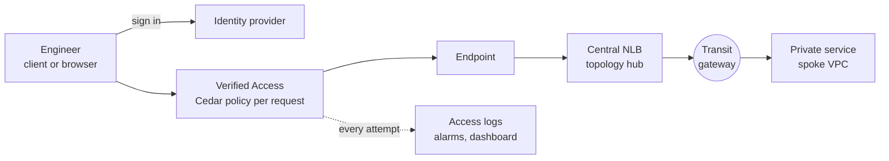

<!-- markdownlint-disable -->
<a href="https://www.appvia.io/"></a><br/><p align="right"> <a href="https://registry.terraform.io/modules/appvia/verified-access/aws/latest"></a></a> <a href="https://github.com/appvia/terraform-aws-verified-access/releases/latest"></a> <a href="https://appvia-community.slack.com/join/shared_invite/zt-1s7i7xy85-T155drryqU56emm09ojMVA#/shared-invite/email"></a> <a href="https://github.com/appvia/terraform-aws-verified-access/graphs/contributors"></a>

<!-- markdownlint-restore -->
<!--
  ***** CAUTION: DO NOT EDIT ABOVE THIS LINE ******
-->


# Terraform AWS Verified Access

## Description

This module provisions [AWS Verified Access](https://docs.aws.amazon.com/verified-access/latest/ug/what-is-verified-access.html) as a managed, identity- and device-aware replacement for bastion hosts and hosted workstations. It manages the Verified Access instance, user and device trust providers, groups, endpoints (load balancer, network interface, CIDR and RDS) and access logging.

Access policies are declared as structured input and rendered to [Cedar](https://www.cedarpolicy.com/) by the module, so reviewers read who may reach what rather than raw policy. Users reach TCP services (SSH, RDP, databases) through the Connectivity Client and web applications in the browser; every attempt is checked against their identity group and logged.



The module consumes an existing network (VPC, dedicated subnets and, for `hub`, a transit gateway) and never creates VPCs or subnets. It creates DNS records only when you give it a Route 53 hosted zone (`dns`); otherwise publish `certificate_validation_records` and the `application_domains` CNAMEs in whichever DNS hosts your domain.

## Usage

One module block; every option below is a value or an on/off toggle.

```hcl
module "verified_access" {
  source  = "appvia/verified-access/aws"
  version = "0.1.0"

  name       = "production"
  subnet_ids = ["subnet-0123456789abcdef0", "subnet-0123456789abcdef1"] # dedicated Verified Access subnets in the hub
  tags       = { Environment = "Production" }
  topology   = "hub" # or "single-vpc" (default) when the services share the VPC
  vpc_id     = "vpc-0123456789abcdef0"

  user_trust_provider = {
    type = "iam-identity-center"
  }

  access_logs = {
    include_trust_context = true
    cloudwatch            = {}
    s3                    = { bucket_name = "log-archive-verified-access", bucket_owner = "111111111111" }
  }

  ## Optional: fixed addresses for the central load balancer, so firewalls and tenants can allow exact IPs
  load_balancer = {
    private_ips = {
      "subnet-0123456789abcdef0" = "10.10.0.100"
      "subnet-0123456789abcdef1" = "10.10.1.100"
    }
  }

  ## Optional: a wildcard certificate for http/https endpoints, with its validation records and the application
  ## CNAMEs published in a Route 53 hosted zone (leave dns out to publish them in your own DNS)
  certificate = {
    domain_name         = "example.com"
    wait_for_validation = true
  }
  dns = {
    zone_id = "Z0123456789ABCDEFGHIJ"
  }

  ## Optional: alarms to a new SNS topic (and a PagerDuty topic), and an alarm on changes made by anyone other than
  ## the pipeline role
  alarms = {
    email_addresses        = ["platform-team@example.com"]
    pipeline_role_name     = "verified-access-pipeline"
    additional_action_arns = ["arn:aws:sns:eu-west-2:111111111111:pagerduty"]
  }

  ## Optional: a CloudWatch dashboard and a WAF web ACL with AWS managed rules for the http endpoints
  dashboard = {}
  waf       = { create = true }

  groups = {
    platform-engineers = {
      policy = {
        identity_groups = ["11111111-1111-1111-1111-111111111111"] # Identity Center group ids
        owner           = "platform-team"
        justification   = "Platform engineers administer the tenant hosts"
      }
      tags = { CostCentre = "platform" } # merged over tags on the group and its endpoints
      endpoints = {
        hosts-ssh = {
          type        = "load-balancer"
          port_ranges = [{ from_port = 22, to_port = 22 }]
          targets     = ["10.50.0.10"] # tenant host in a spoke VPC
        }
        build-ssh = {
          type          = "load-balancer"
          port_ranges   = [{ from_port = 22, to_port = 22 }] # also SSH on 22 ...
          targets       = ["10.50.0.30"]
          listener_port = 2201 # ... so a listener port of its own: ssh -p 2201 <endpoint domain>
          policy = {
            identity_groups = ["22222222-2222-2222-2222-222222222222"] # and only members also in the build group
          }
        }
        tools-web = {
          type               = "load-balancer"
          protocol           = "http"
          port               = 80
          application_domain = "tools.example.com" # uses the module certificate
          targets            = ["10.50.0.20"]
        }
      }
    }
  }
}
```

See [examples/basic](examples/basic) (single VPC) and [examples/hub](examples/hub) (hub and spoke over a transit gateway) for complete, standalone deployments.

### Several web applications on one domain

`app.example.com` and `app1.example.com`, each reached by a different Identity Center group and sent to different targets ([tested](tests/subdomains.tftest.hcl)):

```hcl
  certificate = { domain_name = "example.com" } # one wildcard certificate, *.example.com, for every application

  groups = {
    app-users = {
      policy = {
        identity_groups = ["11111111-1111-1111-1111-111111111111"] # only this group reaches app.example.com
        owner           = "app-team"
        justification   = "The app team uses the app application"
      }
      endpoints = {
        app = {
          type               = "load-balancer"
          protocol           = "http"
          port               = 80                    # the port the application listens on
          application_domain = "app.example.com"     # users browse to https://app.example.com
          targets            = ["10.50.0.20"]
          listener_port      = 8001                  # internal to the central load balancer, one per application
        }
      }
    }
    app1-users = {
      policy = {
        identity_groups = ["22222222-2222-2222-2222-222222222222"] # a different group for app1.example.com
        owner           = "finance-team"
        justification   = "The finance team uses the app1 application"
      }
      endpoints = {
        app1 = {
          type               = "load-balancer"
          protocol           = "http"
          port               = 80
          application_domain = "app1.example.com"
          targets            = ["10.50.1.30", "10.50.1.31"] # balanced across both
          listener_port      = 8002
        }
      }
    }
  }
```

- **One certificate, one endpoint per subdomain.** The wildcard certificate covers every `*.example.com` application, but AWS needs one endpoint per application domain (so each is priced as one application). The apex `example.com` is not covered by a wildcard; use subdomains.
- **Different groups:** a group per audience, as above. For one audience with an application only some of its members may reach, keep one group and narrow that endpoint with an [endpoint policy](docs/policies.md#3-narrow-one-endpoint-to-some-of-the-groups-teams).
- **Different targets:** each endpoint has its own `targets`; several addresses are load balanced.
- **Listener ports** only need to be unique on the central load balancer; users always use `https://<application domain>`.
- **DNS:** a CNAME from each application domain to its endpoint domain (output `application_domains`), or let the module create them with `dns`.

### Policy gate in a deployment pipeline

The Cedar checks are a reusable GitHub action. A deployment repository runs it on every pull request and makes the plan depend on it:

```yaml
jobs:
  policy-gate:
    runs-on: ubuntu-latest
    steps:
      - uses: actions/checkout@v4
      - uses: appvia/terraform-aws-verified-access/.github/actions/policy-gate@v0.1.0
        with:
          paths: policies                                     # the reviewed Cedar copies
          terraform-test-args: -var-file=values/production.tfvars # rendered policies must match them
  terraform:
    needs: policy-gate
    # ... the usual plan and apply workflow
```

It checks that the policies the module renders match the reviewed copies, then lints them with the rule set and the official Cedar CLI, using the lint script from the same module version as the action ([how policies are checked](docs/security.md#how-policies-are-rendered-and-checked)).

### Options

Everything around Verified Access is self-service from the same module block, each part switched on by setting its input:

| Input | Creates | Default |
| --- | --- | --- |
| `topology = "hub"` | A central internal NLB (`<name_prefix>-<name>`) with its own security group; a listener and IP target group per endpoint with `targets`, reaching services in spoke VPCs across a transit gateway | `"single-vpc"`: no load balancer |
| `load_balancer` | Fixed private IPs per subnet, deletion protection and the TCP idle timeout of the central NLB | AWS assigned IPs, 350 second idle timeout |
| `certificate` | A DNS validated wildcard ACM certificate (`*.<domain_name>`) for http/https endpoints without their own; the validation records are an output | Off |
| `alarms` | An SNS topic (or use yours), alarms on the log derived metrics and per target group, and an EventBridge alarm on changes made outside the pipeline; each can be turned off or tuned (`alarms.rules`), and custom alarms added on any metric in output `metrics` (`alarms.custom`) | Off |
| `dashboard` | A CloudWatch dashboard: access decisions, HTTP errors, healthy targets, who is connecting | Off |
| `metric_stream` | A CloudWatch metric stream to a Firehose delivery stream, e.g. for an external observability platform; `metric_stream.include` streams only the chosen metrics | Off |
| `waf` | An AWS WAF web ACL association (yours, or one created with AWS managed rule groups); http/https endpoints only | Off |
| `dns` | Route 53 records in your public hosted zone: the certificate validation records and a CNAME per http/https `application_domain` inside the zone (others are left to you, with a plan warning) | Off: publish them yourself |
| `fips_enabled` | FIPS 140-2 validated endpoints on the instance (US, Canada and GovCloud regions only; changing it replaces the instance) | `false` |
| `access_logs.cloudwatch.metric_filters` | Chooses the log derived metrics (`access-allowed`, `access-denied`, `http-504`, `http-5xx`); output `metrics` lists every metric available | All four |

Per group and endpoint, inside `groups`:

| Setting | What it does | Default |
| --- | --- | --- |
| `endpoints.<name>.policy` | A structured endpoint policy: `identity_groups` narrowing the group's audience and `additional_conditions` (Cedar), combined with AND and with the group policy | Group policy only |
| `endpoints.<name>.listener_port` | The central NLB listener port, which is also the port clients connect to; puts several services on the same port (e.g. SSH on 22) behind the NLB | The endpoint port |
| `endpoints.<name>.target_details` | Instead of `targets`: addresses with their own port and availability zone | `targets` on the endpoint port, zone `all` |
| `endpoints.<name>.health_check`, `deregistration_delay`, `preserve_client_ip`, `proxy_protocol_v2` | Target group settings on the central NLB | TCP on the traffic port; 300 seconds; off; off |
| `tags` (group and endpoint) | Tags merged over `tags` on the group, its endpoints, their security groups, target groups and listeners, e.g. for chargeback | None |

Create or use existing: each supporting resource is either created by the module (`create = true`, or `create_<thing> = true` where an input holds several) or an existing one named by you, never both (the plan fails otherwise); where the module creates it by default, the flag defaults to `true` and the existing one needs it set to `false`. Details and caveats are in [create or bring your own](docs/how-it-works.md#create-or-bring-your-own).

| Resource | Create | Use existing | Default |
| --- | --- | --- | --- |
| Verified Access instance and trust providers | `user_trust_provider` (and `device_trust_provider`) | `existing_instance = { id = "vai-...", user_policy_reference_name = "idc" }`: the module adds only groups, endpoints and the central NLB | Created |
| KMS key for trust providers, groups and endpoints | `create_kms_key = true` | `kms_key_arn` | None (AWS owned keys) |
| Access log group | `access_logs.cloudwatch = {}` (`create = true`) | `access_logs.cloudwatch = { create = false, log_group_name = "..." }`, with the metric filters and queries attached to it | Created |
| Access log group key | `access_logs.cloudwatch.create_kms_key = true` | `access_logs.cloudwatch.kms_key_arn` | None |
| Access log bucket | `access_logs.s3 = { create = true }` (retention, Object Lock, SSE-KMS options) | `access_logs.s3 = { bucket_name = "..." }`, e.g. in a log archive account | Off |
| Access log Firehose stream | `access_logs.firehose = { create = true, destination_bucket_arn = "..." }` | `access_logs.firehose = { delivery_stream_name = "..." }` | Off |
| Endpoint security group | `endpoints.<name>.create_security_group = true` | `create_security_group = false` with `security_group_ids` | Created |
| Central NLB security group | `load_balancer.create_security_group = true` | `create_security_group = false` with `load_balancer.security_group_ids` | Created |
| Metric stream role | `metric_stream.create_role = true` | `metric_stream.role_arn` | One is required |
| Alarm topic and key | `alarms = {}` (`create_sns_topic = true`), `alarms.create_kms_key = true` | `alarms = { create_sns_topic = false, sns_topic_arn = "..." }`, `alarms.kms_key_arn` | Topic created |
| WAF web ACL | `waf = { create = true }` | `waf = { web_acl_arn = "..." }` | Off |
| Route 53 hosted zone | Not offered | `dns = { zone_id = "..." }` | Off |

Also: `load_balancer.cross_zone_enabled` (default on), `alarms.rules`, `alarms.custom` and `alarms.additional_action_arns` (see [operations](docs/operations.md#customising-the-alarms)), `access_logs.cloudwatch.create_queries` (default on), `user_trust_provider.oidc.groups_claim` (default `groups`) and a separate OIDC native application client (`native_client_id`, `native_scope`, `oidc_native_client_secret`).

## Documentation

| Page | Read it when |
| --- | --- |
| [Getting started](docs/getting-started.md) | **Start here.** Prerequisites, the module block line by line, the first deployment, everyday changes, moving off bastions, teardown |
| [How it works](docs/how-it-works.md) | Network questions: components, diagrams, traffic paths, hub or single VPC, do I need the central NLB, firewall checklist, quotas, limitations |
| [Security](docs/security.md) | The approval gate, how policies are rendered and checked, identity, the identity header applications receive, pipeline role permissions, logging |
| [Access policies](docs/policies.md) | Cedar for beginners, how group and endpoint policies are evaluated, a cookbook of worked examples, gotchas |
| [Operations](docs/operations.md) | Metrics, alarms, dashboard, metric stream, runbook, troubleshooting, certificate validation, teardown |
| [Reference](docs/reference.md) | Every input, nested setting and output, with defaults (generated by `scripts/generate-reference.py`) |
| [Cost](docs/cost.md) | Prices and the break-even with per user jump boxes |
| [Decision records](docs/adr/) | Why the design is the way it is |

## Update Documentation

The `terraform-docs` utility is used to generate this README. Follow the below steps to update:

1. Make changes to the `.terraform-docs.yml` file
2. Fetch the `terraform-docs` binary (https://terraform-docs.io/user-guide/installation/)
3. Run `terraform-docs markdown table --output-file ${PWD}/README.md --output-mode inject .`

<!-- BEGIN_TF_DOCS -->
## Providers

| Name | Version |
|------|---------|
| <a name="provider_aws"></a> [aws](#provider\_aws) | >= 6.0.0, < 7.0.0 |

## Inputs

| Name | Description | Type | Default | Required |
|------|-------------|------|---------|:--------:|
| <a name="input_name"></a> [name](#input\_name) | The name of the Verified Access deployment, used to name and tag all resources, e.g. production | `string` | n/a | yes |
| <a name="input_subnet_ids"></a> [subnet\_ids](#input\_subnet\_ids) | The dedicated subnets for the Verified Access endpoint network interfaces, one per availability zone | `list(string)` | n/a | yes |
| <a name="input_tags"></a> [tags](#input\_tags) | The tags to apply to all resources | `map(string)` | n/a | yes |
| <a name="input_vpc_id"></a> [vpc\_id](#input\_vpc\_id) | The VPC containing the dedicated Verified Access subnets, used for the endpoint security groups | `string` | n/a | yes |
| <a name="input_access_logs"></a> [access\_logs](#input\_access\_logs) | Access logging configuration for the Verified Access instance; null disables logging (a check warns). Set for every live environment | <pre>object({<br/>    ## The OCSF log version (ocsf-0.1, ocsf-1.0.0-rc.2); rc.2 is required for trust context and TCP endpoints<br/>    log_version = optional(string, "ocsf-1.0.0-rc.2")<br/>    ## Include identity and device trust context in the logs; this is personal data, so it is opt-in<br/>    include_trust_context = optional(bool, false)<br/>    ## CloudWatch Logs destination: a log group the module creates (the default, so retention is always bounded), or an<br/>    ## existing one (create = false and log_group_name)<br/>    cloudwatch = optional(object({<br/>      # Create the log group; false delivers to an existing log group (log_group_name), whose retention and<br/>      # encryption are then owned elsewhere, and retention_in_days and kms_key_arn are ignored<br/>      create = optional(bool, true)<br/>      # The name of the existing log group; with create, the name of the log group to create, defaulting to<br/>      # /aws/<name_prefix>/<name><br/>      log_group_name = optional(string, null)<br/>      # The number of days to retain the logs<br/>      retention_in_days = optional(number, 90)<br/>      # An optional customer managed KMS key used to encrypt the log group; its key policy must permit<br/>      # logs.<region>.amazonaws.com<br/>      kms_key_arn = optional(string, null)<br/>      # Instead of kms_key_arn: create a customer managed KMS key (alias/<name_prefix>-<name>-access-logs, rotation<br/>      # on) encrypting the created log group, usable only by CloudWatch Logs for that log group<br/>      create_kms_key = optional(bool, false)<br/>      # The log derived metrics to create, by key of the metrics output: access-allowed, access-denied, http-504 and<br/>      # http-5xx; null creates them all, [] none. Alarms, the dashboard and the metric stream need the ones they use<br/>      metric_filters = optional(list(string), null)<br/>      # Create the saved Logs Insights queries who-is-connecting and denied-requests<br/>      create_queries = optional(bool, true)<br/>    }), null)<br/>    ## S3 destination: an existing bucket (bucket_name, e.g. in the log archive account, carrying its own retention and<br/>    ## object lock), or one the module creates in this account (create = true)<br/>    s3 = optional(object({<br/>      # Create the bucket, with versioning, encryption, a public access block, bucket owner enforced ownership, a<br/>      # TLS only policy permitting Verified Access log delivery, a lifecycle expiry and optional object lock<br/>      create = optional(bool, false)<br/>      # The name of the existing bucket; with create, the name of the bucket to create, defaulting to<br/>      # <name_prefix>-<name>-access-logs-<account id><br/>      bucket_name = optional(string, null)<br/>      # The account id that owns an existing bucket, required when the bucket is in another account<br/>      bucket_owner = optional(string, null)<br/>      # An optional prefix for the log objects<br/>      prefix = optional(string, null)<br/>      # Created bucket only: the days after which log objects expire (and their old versions a day later)<br/>      retention_days = optional(number, 365)<br/>      # Created bucket only: S3 Object Lock default retention, making each log object undeletable for days. Object<br/>      # Lock can only be enabled when the bucket is created and never turned off; in COMPLIANCE mode nobody, not even<br/>      # the root user, can delete a locked object or the bucket until the retention ends<br/>      object_lock = optional(object({<br/>        ## The retention mode, COMPLIANCE or GOVERNANCE (users with s3:BypassGovernanceRetention may delete)<br/>        mode = optional(string, "COMPLIANCE")<br/>        ## The days each object is locked for<br/>        days = number<br/>      }), null)<br/>      # Created bucket only: a customer managed KMS key (SSE-KMS) for the log objects, defaulting to SSE-S3; its key<br/>      # policy must permit delivery.logs.amazonaws.com<br/>      kms_key_arn = optional(string, null)<br/>      # Created bucket only: delete the bucket on destroy even when it holds log objects (locked objects still block it)<br/>      force_destroy = optional(bool, false)<br/>    }), null)<br/>    ## Kinesis Data Firehose destination, e.g. for a third party SIEM: an existing delivery stream<br/>    ## (delivery_stream_name), or one the module creates in this account (create = true) writing to an S3 bucket<br/>    firehose = optional(object({<br/>      # Create the delivery stream, with the IAM role it writes to destination_bucket_arn with<br/>      create = optional(bool, false)<br/>      # The name of the existing delivery stream; with create, the name of the stream to create, defaulting to<br/>      # <name_prefix>-<name>-access-logs<br/>      delivery_stream_name = optional(string, null)<br/>      # Created stream only, and required with it: the ARN of the S3 bucket the delivery stream writes to; a bucket in<br/>      # another account must permit the delivery stream role (output access_log_firehose_role_arn) in its bucket policy<br/>      destination_bucket_arn = optional(string, null)<br/>      # Created stream only: an optional prefix for the delivered objects<br/>      prefix = optional(string, null)<br/>      # Created stream only: the seconds the delivery stream buffers before writing (0-900)<br/>      buffering_interval = optional(number, 300)<br/>      # Created stream only: the MiB the delivery stream buffers before writing (1-128)<br/>      buffering_size = optional(number, 5)<br/>      # Created stream only: an optional customer managed KMS key encrypting the delivered objects (SSE-KMS); the role<br/>      # may use it via S3<br/>      kms_key_arn = optional(string, null)<br/>    }), null)<br/>  })</pre> | `null` | no |
| <a name="input_alarms"></a> [alarms](#input\_alarms) | Alarms on the log derived metrics, the central load balancer and changes made outside the pipeline; null disables alarms. Each alarm can be turned off or tuned in rules, and custom alarms added on any metric the module makes available (output metrics). The log derived alarms need CloudWatch access logs with their metric filters | <pre>object({<br/>    ## Create the topic the alarms notify (<name_prefix>-<name>-alarms); false notifies the existing topic in<br/>    ## sns_topic_arn instead<br/>    create_sns_topic = optional(bool, true)<br/>    ## The existing SNS topic to notify, with create_sns_topic = false<br/>    sns_topic_arn = optional(string, null)<br/>    ## Encrypt the created topic with a customer managed KMS key the module creates (<name_prefix>-<name>-alarms)<br/>    create_kms_key = optional(bool, false)<br/>    ## Encrypt the created topic with an existing customer managed KMS key; its key policy must permit CloudWatch and<br/>    ## EventBridge. Leave both unset for an unencrypted topic<br/>    kms_key_arn = optional(string, null)<br/>    ## The email addresses subscribed to the topic; each recipient must confirm the subscription<br/>    email_addresses = optional(list(string), [])<br/>    ## The role the deployment pipeline assumes; when set, any other principal changing Verified Access raises an alarm<br/>    ## (the changed-outside-pipeline rule). The rule is account wide (CloudTrail does not name the instance consistently),<br/>    ## so with several deployments in one account use one pipeline role and enable the rule in one deployment only<br/>    pipeline_role_name = optional(string, null)<br/>    ## Additional ARNs notified on alarm and on recovery, e.g. an SNS topic subscribed by PagerDuty or AWS Chatbot<br/>    additional_action_arns = optional(list(string), [])<br/>    ## Per alarm settings, keyed by alarm: http-504, access-denied, logging-stopped, no-access-allowed,<br/>    ## no-healthy-targets and unhealthy-targets (the last two apply to every endpoint with targets; key one endpoint as<br/>    ## <endpoint>/no-healthy-targets to override it alone), and changed-outside-pipeline (enabled only). An alarm<br/>    ## without a rule, or a setting left unset, keeps the module default (docs/operations.md, Alarms)<br/>    rules = optional(map(object({<br/>      # Create the alarm; false turns it off. Unset means on, or for an <endpoint>/<alarm> key the setting of <alarm><br/>      enabled = optional(bool, null)<br/>      # The threshold compared with the statistic<br/>      threshold = optional(number, null)<br/>      # The period in seconds: 10, 30 or a multiple of 60<br/>      period = optional(number, null)<br/>      # The number of periods evaluated (period x evaluation_periods at most seven days)<br/>      evaluation_periods = optional(number, null)<br/>      # How missing data is treated: missing, ignore, breaching or notBreaching<br/>      treat_missing_data = optional(string, null)<br/>    })), {})<br/>    ## Additional alarms keyed by name (lowercase kebab-case, alarm <name_prefix>-<name>-<key>), on any metric the module<br/>    ## makes available, notifying the same actions<br/>    custom = optional(map(object({<br/>      # The metric, by key of the metrics output, e.g. access-denied or <endpoint>/unhealthy-host-count<br/>      metric = string<br/>      # The comparison: GreaterThanOrEqualToThreshold, GreaterThanThreshold, LessThanThreshold or<br/>      # LessThanOrEqualToThreshold<br/>      comparison_operator = string<br/>      # The threshold compared with the statistic<br/>      threshold = number<br/>      # The statistic: Sum, Average, Minimum, Maximum or SampleCount; the metrics output recommends one per metric<br/>      statistic = optional(string, "Sum")<br/>      # The period in seconds: 10, 30 or a multiple of 60<br/>      period = optional(number, 300)<br/>      # The number of periods evaluated (period x evaluation_periods at most seven days)<br/>      evaluation_periods = optional(number, 1)<br/>      # How missing data is treated: missing, ignore, breaching or notBreaching<br/>      treat_missing_data = optional(string, "missing")<br/>      # The alarm description, shown in the notification<br/>      description = optional(string, null)<br/>    })), {})<br/>  })</pre> | `null` | no |
| <a name="input_allowed_egress_cidr_blocks"></a> [allowed\_egress\_cidr\_blocks](#input\_allowed\_egress\_cidr\_blocks) | The CIDR blocks endpoint security groups may send traffic to when the target range cannot be derived (load-balancer endpoints with their own load balancer, network-interface and rds endpoints); null (the default) uses the address ranges associated with var.vpc\_id, which those targets must be in. Set it to narrow the range, or per endpoint with egress\_cidr\_blocks | `list(string)` | `null` | no |
| <a name="input_certificate"></a> [certificate](#input\_certificate) | An optional wildcard public certificate (*.<domain\_name>) for http and https endpoints that set no domain\_certificate\_arn; publish the certificate\_validation\_records output in the domain's DNS | <pre>object({<br/>    ## The domain the certificate covers, e.g. example.com requests *.example.com<br/>    domain_name = string<br/>    ## Wait for the certificate to be issued before creating the endpoints that use it; publish the validation records first<br/>    wait_for_validation = optional(bool, false)<br/>  })</pre> | `null` | no |
| <a name="input_cidr_endpoints_custom_subdomain"></a> [cidr\_endpoints\_custom\_subdomain](#input\_cidr\_endpoints\_custom\_subdomain) | An optional custom subdomain for CIDR endpoints; delegate it to the name servers exported by the module | `string` | `null` | no |
| <a name="input_create_kms_key"></a> [create\_kms\_key](#input\_create\_kms\_key) | Instead of kms\_key\_arn: create a customer managed KMS key (alias/<name\_prefix>-<name>, rotation on) encrypting the Verified Access trust providers, groups and endpoints, usable by Verified Access in this account. Deleting it makes their configuration unreadable, so it is deleted after a 30 day window | `bool` | `false` | no |
| <a name="input_dashboard"></a> [dashboard](#input\_dashboard) | An optional CloudWatch dashboard (<name\_prefix>-<name>) showing access decisions, HTTP errors, load balancer health and who is connecting; null disables it. Requires CloudWatch access logs with the metric filters access-allowed, access-denied, http-504 and http-5xx | <pre>object({<br/>    ## The period in seconds of the metric widgets<br/>    period = optional(number, 300)<br/>  })</pre> | `null` | no |
| <a name="input_description"></a> [description](#input\_description) | The description of the Verified Access instance | `string` | `null` | no |
| <a name="input_device_trust_provider"></a> [device\_trust\_provider](#input\_device\_trust\_provider) | An optional device posture trust provider; null disables device posture | <pre>object({<br/>    ## The type of device trust provider (crowdstrike, jamf, jumpcloud)<br/>    type = string<br/>    ## The Cedar context key for the provider, defaults to the type, e.g. context.crowdstrike<br/>    policy_reference_name = optional(string, null)<br/>    ## The tenant id of the device provider application<br/>    tenant_id = string<br/>    ## CrowdStrike only: the minimum assessment.overall score (1-100) for sensitive endpoints<br/>    crowdstrike_min_score = optional(number, 50)<br/>    ## Jamf only: the risk levels permitted for sensitive endpoints<br/>    jamf_allowed_risk = optional(list(string), ["LOW", "SECURE"])<br/>  })</pre> | `null` | no |
| <a name="input_dns"></a> [dns](#input\_dns) | An optional Route 53 public hosted zone where the module publishes the certificate validation records and the application CNAMEs (application\_domain to endpoint domain) of http and https endpoints; null leaves DNS to the caller (outputs certificate\_validation\_records and application\_domains) | <pre>object({<br/>    ## The id of the public hosted zone of the application domains, e.g. Z0123456789ABCDEFGHIJ<br/>    zone_id = string<br/>    ## Publish the validation records of the module certificate<br/>    create_validation_records = optional(bool, true)<br/>    ## Publish a CNAME from each http and https endpoint application_domain inside the zone (below its apex) to its<br/>    ## endpoint domain; domains outside the zone are skipped with a warning and left to the caller<br/>    create_application_records = optional(bool, true)<br/>    ## The TTL in seconds of the records<br/>    ttl = optional(number, 300)<br/>  })</pre> | `null` | no |
| <a name="input_existing_instance"></a> [existing\_instance](#input\_existing\_instance) | An existing Verified Access instance to add the groups and endpoints to, instead of creating one; null (the default) creates the instance. The instance, its trust providers, logging and web ACL are then owned elsewhere, so user\_trust\_provider, device\_trust\_provider, the OIDC client secrets, access\_logs (and with it alarms, dashboard and metric\_stream), waf, fips\_enabled, description and cidr\_endpoints\_custom\_subdomain must be left unset; the settings below describe the attached trust providers so the module can render the policies | <pre>object({<br/>    ## The id of the instance, e.g. vai-0123456789abcdef0<br/>    id = string<br/>    ## The type of the user trust provider attached to the instance (iam-identity-center, oidc), which decides how<br/>    ## identity groups are rendered<br/>    user_trust_provider_type = optional(string, "iam-identity-center")<br/>    ## The Cedar context key (policy reference name) of the attached user trust provider, e.g. idc<br/>    user_policy_reference_name = string<br/>    ## OIDC only: the claim holding the user's groups, as in user_trust_provider.oidc.groups_claim<br/>    user_groups_claim = optional(string, "groups")<br/>    ## IAM Identity Center only: require a verified email address in every group policy, as in<br/>    ## user_trust_provider.require_verified_email<br/>    require_verified_email = optional(bool, false)<br/>    ## The device trust provider attached to the instance, needed for sensitive endpoints; null when none is attached<br/>    device_trust_provider = optional(object({<br/>      # The type of device trust provider (crowdstrike, jamf, jumpcloud)<br/>      type = string<br/>      # The Cedar context key (policy reference name) of the attached provider, defaults to the type<br/>      policy_reference_name = optional(string, null)<br/>      # CrowdStrike only: the minimum assessment.overall score (1-100) for sensitive endpoints<br/>      crowdstrike_min_score = optional(number, 50)<br/>      # Jamf only: the risk levels permitted for sensitive endpoints<br/>      jamf_allowed_risk = optional(list(string), ["LOW", "SECURE"])<br/>    }), null)<br/>  })</pre> | `null` | no |
| <a name="input_fips_enabled"></a> [fips\_enabled](#input\_fips\_enabled) | Enable FIPS 140-2 validated endpoints on the Verified Access instance. Only supported in US, Canada and AWS GovCloud (US) regions (a check warns elsewhere); changing it replaces the instance and everything in it | `bool` | `false` | no |
| <a name="input_groups"></a> [groups](#input\_groups) | The Verified Access groups keyed by name; each group holds its access policy and the endpoints it protects | <pre>map(object({<br/>    ## The description of the group<br/>    description = optional(string, null)<br/>    ## The structured access policy (preferred), rendered to Cedar by the module<br/>    policy = optional(object({<br/>      # The identity groups permitted: Identity Center group ids, or OIDC group names (escaped in the Cedar strings)<br/>      identity_groups = list(string)<br/>      # The team accountable for this access<br/>      owner = string<br/>      # Why this access exists<br/>      justification = string<br/>    }), null)<br/>    ## Escape hatch: a raw Cedar policy, e.g. file("policies/raw/<name>.cedar"); requires security review<br/>    raw_policy = optional(object({<br/>      # The Cedar policy text<br/>      cedar = string<br/>      # The team accountable for this access<br/>      owner = string<br/>      # Why the structured policy cannot express this access<br/>      justification = string<br/>    }), null)<br/>    ## Tags merged over var.tags on the group and on every endpoint in it, e.g. a cost centre for chargeback<br/>    tags = optional(map(string), {})<br/>    ## The endpoints in this group keyed by name; names must be unique across all groups<br/>    endpoints = optional(map(object({<br/>      # The endpoint type (load-balancer, network-interface, cidr, rds); cidr endpoints only reach addresses in the<br/>      # endpoint's own VPC, so reach services across a transit gateway with a load-balancer endpoint and an NLB<br/>      # with IP targets<br/>      type = string<br/>      # The description of the endpoint<br/>      description = optional(string, null)<br/>      # The protocol (http, https, tcp); cidr and rds endpoints are tcp only<br/>      protocol = optional(string, "tcp")<br/>      # Sensitive endpoints receive an endpoint policy requiring device posture<br/>      sensitive = optional(bool, false)<br/>      # The port for http/https and rds endpoints<br/>      port = optional(number, null)<br/>      # The port ranges for tcp endpoints<br/>      port_ranges = optional(list(object({<br/>        ## The first port of the range<br/>        from_port = number<br/>        ## The last port of the range (the same as from_port for a single port)<br/>        to_port = number<br/>      })), [])<br/>      # The load balancer arn (load-balancer endpoints)<br/>      load_balancer_arn = optional(string, null)<br/>      # The IPv4 addresses of the service across the transit gateway (load-balancer endpoints with topology hub); the<br/>      # module creates a listener and target group on the central load balancer instead of using load_balancer_arn<br/>      targets = optional(list(string), [])<br/>      # Instead of targets: the service addresses with an optional per target port (defaults to the endpoint port)<br/>      # and availability zone ("all" for addresses outside the load balancer VPC, or the zone name of an address<br/>      # inside it)<br/>      target_details = optional(list(object({<br/>        ## The IPv4 address of the target<br/>        ip = string<br/>        ## The port of the target, defaults to the endpoint port<br/>        port = optional(number, null)<br/>        ## The availability zone of the target; all for addresses across a transit gateway<br/>        availability_zone = optional(string, "all")<br/>      })), [])<br/>      # Hub only: the port of the listener on the central load balancer, which is also the port clients connect to<br/>      # on the endpoint domain; defaults to the endpoint port. Set it to put several services on the same port (e.g.<br/>      # SSH hosts on 22) behind the central load balancer: each keeps port_ranges (or port) as its service port<br/>      listener_port = optional(number, null)<br/>      # Hub only: the target group health check; defaults to TCP on the traffic port<br/>      health_check = optional(object({<br/>        ## The health check protocol (TCP, HTTP or HTTPS)<br/>        protocol = optional(string, "TCP")<br/>        ## The port checked, defaults to the port receiving traffic<br/>        port = optional(string, "traffic-port")<br/>        ## The path checked (HTTP and HTTPS health checks only)<br/>        path = optional(string, null)<br/>        ## Consecutive successes before a target is healthy (2-10)<br/>        healthy_threshold = optional(number, 3)<br/>        ## Consecutive failures before a target is unhealthy (2-10)<br/>        unhealthy_threshold = optional(number, 3)<br/>        ## The seconds between checks (5-300)<br/>        interval = optional(number, 30)<br/>      }), null)<br/>      # Hub only: the seconds the target group drains a deregistered target (0-3600), defaults to 300<br/>      deregistration_delay = optional(number, null)<br/>      # Hub only: preserve the client address at the target, defaults to false. Targets across a transit gateway<br/>      # reply to that address directly, bypassing the load balancer, so leave it off unless the return path is known<br/>      preserve_client_ip = optional(bool, null)<br/>      # Hub only: send a proxy protocol v2 header to the targets, defaults to false; the targets must expect it<br/>      proxy_protocol_v2 = optional(bool, null)<br/>      # The network interface id (network-interface endpoints)<br/>      network_interface_id = optional(string, null)<br/>      # The CIDR block (cidr endpoints)<br/>      cidr = optional(string, null)<br/>      # The RDS target (rds endpoints); set exactly one of the arns<br/>      rds = optional(object({<br/>        ## The RDS instance ARN<br/>        instance_arn = optional(string, null)<br/>        ## The Aurora cluster ARN<br/>        cluster_arn = optional(string, null)<br/>        ## The RDS Proxy ARN<br/>        proxy_arn = optional(string, null)<br/>        ## The database endpoint address users connect to<br/>        endpoint = string<br/>      }), null)<br/>      # The public DNS name users browse to (http/https endpoints only)<br/>      application_domain = optional(string, null)<br/>      # The public ACM certificate for the application domain (http/https endpoints only)<br/>      domain_certificate_arn = optional(string, null)<br/>      # The prefix for the generated endpoint domain, defaults to the endpoint name<br/>      endpoint_domain_prefix = optional(string, null)<br/>      # Override the subnets for this endpoint, defaults to var.subnet_ids<br/>      subnet_ids = optional(list(string), null)<br/>      # Additional security groups to attach to the endpoint; with create_security_group false, the only ones<br/>      security_group_ids = optional(list(string), [])<br/>      # Create the endpoint security group (<name_prefix>-<name>-<endpoint>, egress only to the targets); false uses<br/>      # only security_group_ids, whose rules must then allow the endpoint to reach its targets<br/>      create_security_group = optional(bool, true)<br/>      # Override the CIDR blocks the endpoint security group may send to<br/>      egress_cidr_blocks = optional(list(string), null)<br/>      # A structured endpoint policy, evaluated in addition to the group policy (both must allow): identity groups<br/>      # narrowing the group's audience and additional Cedar conditions, all combined with AND (and with the device<br/>      # condition when sensitive). The owner and justification default to the group's<br/>      policy = optional(object({<br/>        ## The identity groups permitted to this endpoint (any of); empty leaves the group policy's audience<br/>        identity_groups = optional(list(string), [])<br/>        ## Extra Cedar conditions, all of which must hold: each one line, rendered in its own parentheses, so its<br/>        ## brackets must balance outside string literals (at most ten deep), without ;, //, permit, forbid, when or unless<br/>        additional_conditions = optional(list(string), [])<br/>        ## The team accountable for this access, defaults to the group policy owner<br/>        owner = optional(string, null)<br/>        ## Why this access exists, defaults to the group policy justification<br/>        justification = optional(string, null)<br/>      }), null)<br/>      # Escape hatch: a raw Cedar endpoint policy; requires security review<br/>      raw_policy = optional(object({<br/>        ## The Cedar policy text<br/>        cedar = string<br/>        ## The team accountable for this access<br/>        owner = string<br/>        ## Why the structured policy cannot express this access<br/>        justification = string<br/>      }), null)<br/>      # Tags merged over var.tags and the group tags on the endpoint, its security group, target group and listener<br/>      tags = optional(map(string), {})<br/>    })), {})<br/>  }))</pre> | `{}` | no |
| <a name="input_kms_key_arn"></a> [kms\_key\_arn](#input\_kms\_key\_arn) | An optional customer managed KMS key used to encrypt Verified Access trust providers, groups and endpoints; its key policy must permit kms:CreateGrant, DescribeKey, GenerateDataKey and Decrypt via verified-access.<region>.amazonaws.com | `string` | `null` | no |
| <a name="input_load_balancer"></a> [load\_balancer](#input\_load\_balancer) | Settings for the central internal network load balancer created with topology hub, which reaches services across the transit gateway | <pre>object({<br/>    ## Fixed private IPv4 addresses for the load balancer keyed by subnet id, so firewalls and tenants can allow exact<br/>    ## addresses; changing them replaces the load balancer<br/>    private_ips = optional(map(string), {})<br/>    ## Protect the load balancer from deletion<br/>    enable_deletion_protection = optional(bool, false)<br/>    ## The idle timeout in seconds of the TCP listeners (60-6000); keep SSH sessions alive with ServerAliveInterval<br/>    tcp_idle_timeout_seconds = optional(number, 350)<br/>    ## Balance across the targets in every availability zone; IP targets across a transit gateway have no zone of<br/>    ## their own (availability zone all), so leave it on unless the targets are zonal<br/>    cross_zone_enabled = optional(bool, true)<br/>    ## The rules per security group quota of the account (default 60, inbound and outbound counted separately, one<br/>    ## rule per address range); raise it here after raising the quota (Service Quotas, Amazon VPC)<br/>    max_security_group_rules = optional(number, 60)<br/>    ## Create the load balancer security group (<name_prefix>-<name>-nlb, in from the module subnets on the listener<br/>    ## ports, out to each target); false uses only security_group_ids, whose rules must then allow the endpoint<br/>    ## subnets in on the listener ports and the targets out on their target and health check ports<br/>    create_security_group = optional(bool, true)<br/>    ## Security groups attached to the load balancer: in addition to the created one, or instead of it with<br/>    ## create_security_group false<br/>    security_group_ids = optional(list(string), [])<br/>  })</pre> | `{}` | no |
| <a name="input_metric_stream"></a> [metric\_stream](#input\_metric\_stream) | An optional CloudWatch metric stream to a Kinesis Data Firehose delivery stream, e.g. for an external observability platform: by default the log derived metrics and, with topology hub, the AWS/NetworkELB namespace, or only the metrics chosen in include; null disables it | <pre>object({<br/>    ## The ARN of the Kinesis Data Firehose delivery stream receiving the metrics<br/>    firehose_arn = string<br/>    ## The ARN of an existing IAM role CloudWatch assumes to write to the delivery stream<br/>    role_arn = optional(string, null)<br/>    ## Instead of role_arn: create the role (<name_prefix>-<name>-metric-stream), trusted by CloudWatch metric streams<br/>    ## in this account and permitted to write only to firehose_arn<br/>    create_role = optional(bool, false)<br/>    ## The output format (json, opentelemetry0.7, opentelemetry1.0)<br/>    output_format = optional(string, "opentelemetry1.0")<br/>    ## The metrics to stream, by key of the metrics output, e.g. ["access-denied", "<endpoint>/healthy-host-count"];<br/>    ## null streams every log derived metric and, with topology hub, the whole AWS/NetworkELB namespace. A stream<br/>    ## filters by namespace and metric name, not dimension, so an AWS/NetworkELB or AWS/Logs metric is streamed for<br/>    ## every load balancer or log group in the account and region<br/>    include = optional(list(string), null)<br/>  })</pre> | `null` | no |
| <a name="input_name_prefix"></a> [name\_prefix](#input\_name\_prefix) | The prefix of all resource names, to follow the caller's naming convention, e.g. prod-euw2-va gives prod-euw2-va-<name>-nlb; scope pipeline roles to <name\_prefix>-* | `string` | `"verified-access"` | no |
| <a name="input_oidc_client_secret"></a> [oidc\_client\_secret](#input\_oidc\_client\_secret) | The OAuth client secret for an OIDC user trust provider; source it from a secret store, never from tfvars | `string` | `null` | no |
| <a name="input_oidc_native_client_secret"></a> [oidc\_native\_client\_secret](#input\_oidc\_native\_client\_secret) | The OAuth client secret of a separate native application client (user\_trust\_provider.oidc.native\_client\_id), defaults to oidc\_client\_secret; source it from a secret store, never from tfvars | `string` | `null` | no |
| <a name="input_topology"></a> [topology](#input\_topology) | The network topology: single-vpc (endpoints reach services in their own VPC) or hub (a central internal network load balancer reaches services in spoke VPCs across a transit gateway) | `string` | `"single-vpc"` | no |
| <a name="input_user_trust_provider"></a> [user\_trust\_provider](#input\_user\_trust\_provider) | The user identity trust provider the module creates, IAM Identity Center or an OIDC identity provider; required unless existing\_instance is set, which describes the provider already attached instead | <pre>object({<br/>    ## The type of user trust provider (iam-identity-center, oidc)<br/>    type = string<br/>    ## The Cedar context key for the provider, used by both the trust provider and the rendered policies<br/>    policy_reference_name = optional(string, "idc")<br/>    ## Require a verified email address (IAM Identity Center only); off by default, as directories that do not<br/>    ## verify emails (Identity Center reports email.verified = false) would deny every user<br/>    require_verified_email = optional(bool, false)<br/>    ## The OIDC settings, required when type is oidc<br/>    oidc = optional(object({<br/>      # The OIDC issuer identifier<br/>      issuer = string<br/>      # The OIDC authorization endpoint<br/>      authorization_endpoint = string<br/>      # The OIDC token endpoint<br/>      token_endpoint = string<br/>      # The OIDC user info endpoint<br/>      user_info_endpoint = string<br/>      # The OAuth client id; the secret is passed in oidc_client_secret<br/>      client_id = string<br/>      # The space delimited scopes; offline_access enables refresh tokens<br/>      scope = optional(string, "openid email groups offline_access")<br/>      # The public signing key endpoint, enables native application (Connectivity Client) access<br/>      public_signing_key_endpoint = optional(string, null)<br/>      # The claim holding the user's groups, rendered into the policies as context.<policy_reference_name>.<claim>;<br/>      # a dotted path reaches a nested claim, e.g. additional_user_context.groups<br/>      groups_claim = optional(string, "groups")<br/>      # A separate OAuth client for the native application (Connectivity Client), defaults to client_id; its secret<br/>      # is passed in oidc_native_client_secret<br/>      native_client_id = optional(string, null)<br/>      # The scopes of the native application client, defaults to scope<br/>      native_scope = optional(string, null)<br/>    }), null)<br/>  })</pre> | `null` | no |
| <a name="input_waf"></a> [waf](#input\_waf) | An optional AWS WAF web ACL for the instance, either an existing one or one created by the module with AWS managed rule groups; null disables it. WAF applies to http and https endpoints only, and with IAM Identity Center it inspects requests before sign-in | <pre>object({<br/>    ## The ARN of an existing regional web ACL to associate<br/>    web_acl_arn = optional(string, null)<br/>    ## Create a regional web ACL (<name_prefix>-<name>) with the AWS common, known bad inputs and IP reputation rule groups<br/>    create = optional(bool, false)<br/>  })</pre> | `null` | no |

## Outputs

| Name | Description |
|------|-------------|
| <a name="output_access_log_bucket_arn"></a> [access\_log\_bucket\_arn](#output\_access\_log\_bucket\_arn) | The ARN of the S3 bucket created for the access logs, when access\_logs.s3.create |
| <a name="output_access_log_bucket_name"></a> [access\_log\_bucket\_name](#output\_access\_log\_bucket\_name) | The name of the S3 bucket receiving the access logs, created or existing, when enabled |
| <a name="output_access_log_firehose_arn"></a> [access\_log\_firehose\_arn](#output\_access\_log\_firehose\_arn) | The ARN of the Firehose delivery stream created for the access logs, when access\_logs.firehose.create |
| <a name="output_access_log_firehose_role_arn"></a> [access\_log\_firehose\_role\_arn](#output\_access\_log\_firehose\_role\_arn) | The ARN of the IAM role the created Firehose delivery stream writes to its bucket with; a bucket in another account must permit it |
| <a name="output_access_log_group_name"></a> [access\_log\_group\_name](#output\_access\_log\_group\_name) | The name of the CloudWatch log group receiving the access logs, when enabled |
| <a name="output_access_log_kms_key_arn"></a> [access\_log\_kms\_key\_arn](#output\_access\_log\_kms\_key\_arn) | The ARN of the KMS key created to encrypt the access log group, when access\_logs.cloudwatch.create\_kms\_key |
| <a name="output_alarm_kms_key_arn"></a> [alarm\_kms\_key\_arn](#output\_alarm\_kms\_key\_arn) | The ARN of the KMS key encrypting the alarm topic, when encrypted |
| <a name="output_alarm_topic_arn"></a> [alarm\_topic\_arn](#output\_alarm\_topic\_arn) | The ARN of the SNS topic notified by the alarms, when enabled |
| <a name="output_application_domains"></a> [application\_domains](#output\_application\_domains) | A map of application domain to the endpoint domain it must be a CNAME of, for http and https endpoints i.e. tools.example.com => tools-web.edge-xxx.vai-xxx.prod.verified-access.eu-west-2.amazonaws.com; published by the module with dns |
| <a name="output_certificate_arn"></a> [certificate\_arn](#output\_certificate\_arn) | The ARN of the wildcard certificate requested by the module, when enabled |
| <a name="output_certificate_validation_records"></a> [certificate\_validation\_records](#output\_certificate\_validation\_records) | A map of DNS record name to value (CNAME) proving ownership of the certificate domain; publish them in the domain's DNS |
| <a name="output_client_configuration_command"></a> [client\_configuration\_command](#output\_client\_configuration\_command) | The AWS CLI command exporting the Connectivity Client configuration of the instance; needs ec2:ExportVerifiedAccessInstanceClientConfiguration |
| <a name="output_dashboard_name"></a> [dashboard\_name](#output\_dashboard\_name) | The name of the CloudWatch dashboard, when enabled |
| <a name="output_device_trust_provider_id"></a> [device\_trust\_provider\_id](#output\_device\_trust\_provider\_id) | The id of the device trust provider, when the module creates one |
| <a name="output_endpoint_device_validation_domains"></a> [endpoint\_device\_validation\_domains](#output\_endpoint\_device\_validation\_domains) | A map of endpoint name to the domain Verified Access uses to validate devices for it |
| <a name="output_endpoint_domains"></a> [endpoint\_domains](#output\_endpoint\_domains) | A map of endpoint name to the DNS name generated by Verified Access i.e. demo-ssh => edge-xxx.vai-xxx.prod.verified-access.eu-west-2.amazonaws.com |
| <a name="output_endpoint_ids"></a> [endpoint\_ids](#output\_endpoint\_ids) | A map of endpoint name to Verified Access endpoint id |
| <a name="output_endpoint_security_group_ids"></a> [endpoint\_security\_group\_ids](#output\_endpoint\_security\_group\_ids) | A map of endpoint name to the security group the module created for its network interfaces (null with create\_security\_group false); targets must allow traffic from the endpoint subnets |
| <a name="output_group_arns"></a> [group\_arns](#output\_group\_arns) | A map of group name to Verified Access group ARN, e.g. for IAM policies or sharing |
| <a name="output_group_ids"></a> [group\_ids](#output\_group\_ids) | A map of group name to Verified Access group id |
| <a name="output_instance_arn"></a> [instance\_arn](#output\_instance\_arn) | The ARN of the Verified Access instance, created or existing |
| <a name="output_instance_id"></a> [instance\_id](#output\_instance\_id) | The id of the Verified Access instance, created or existing |
| <a name="output_kms_key_arn"></a> [kms\_key\_arn](#output\_kms\_key\_arn) | The ARN of the KMS key encrypting the trust providers, groups and endpoints, created (create\_kms\_key) or supplied, when set |
| <a name="output_load_balancer_arn"></a> [load\_balancer\_arn](#output\_load\_balancer\_arn) | The ARN of the central load balancer, when topology is hub |
| <a name="output_load_balancer_dns_name"></a> [load\_balancer\_dns\_name](#output\_load\_balancer\_dns\_name) | The DNS name of the central load balancer, when topology is hub |
| <a name="output_load_balancer_security_group_id"></a> [load\_balancer\_security\_group\_id](#output\_load\_balancer\_security\_group\_id) | The id of the central load balancer security group created by the module, when topology is hub (null with load\_balancer.create\_security\_group false) |
| <a name="output_metric_namespace"></a> [metric\_namespace](#output\_metric\_namespace) | The CloudWatch namespace of the log derived metrics (AccessAllowed, AccessDenied, Http504, Http5xx), when any metric filter is created |
| <a name="output_metric_stream_role_arn"></a> [metric\_stream\_role\_arn](#output\_metric\_stream\_role\_arn) | The ARN of the IAM role the metric stream writes to Firehose with, created (metric\_stream.create\_role) or supplied, when enabled |
| <a name="output_metrics"></a> [metrics](#output\_metrics) | A map of every metric the module makes available, keyed as alarms.custom metric and metric\_stream.include expect, to { namespace, metric\_name, dimensions, statistic (recommended), source (log metric filter, AWS/Logs or AWS/NetworkELB), description } i.e. access-denied, incoming-log-events, load-balancer-processed-bytes and <endpoint>/healthy-host-count; Verified Access publishes no CloudWatch metrics of its own |
| <a name="output_name_servers"></a> [name\_servers](#output\_name\_servers) | The name servers of the instance, used to delegate cidr\_endpoints\_custom\_subdomain; empty with existing\_instance |
| <a name="output_oidc_redirect_uris"></a> [oidc\_redirect\_uris](#output\_oidc\_redirect\_uris) | A map of http and https endpoint name to the sign-in redirect URI to register with the OIDC client (https://<application\_domain>/oauth2/idpresponse), when the user trust provider is oidc |
| <a name="output_rendered_policies"></a> [rendered\_policies](#output\_rendered\_policies) | A map of the rendered Cedar policies i.e. group/<name> and endpoint/<name> => policy; used for review, lint and golden tests |
| <a name="output_target_group_arns"></a> [target\_group\_arns](#output\_target\_group\_arns) | A map of endpoint name to the ARN of its target group on the central load balancer, for endpoints with targets |
| <a name="output_user_trust_provider_id"></a> [user\_trust\_provider\_id](#output\_user\_trust\_provider\_id) | The id of the user trust provider, when the module creates the instance (null with existing\_instance) |
| <a name="output_web_acl_arn"></a> [web\_acl\_arn](#output\_web\_acl\_arn) | The ARN of the web ACL associated with the instance, when enabled |
<!-- END_TF_DOCS -->
