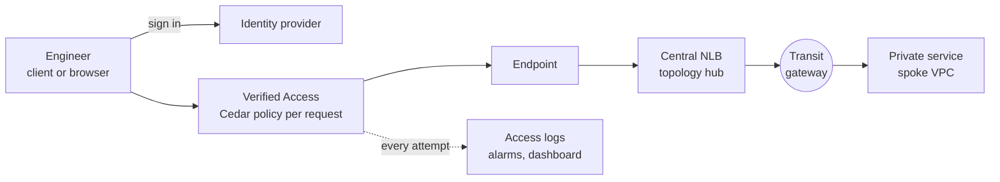

<!-- markdownlint-disable -->
<a href="https://www.appvia.io/"></a><br/><p align="right"> <a href="https://registry.terraform.io/modules/appvia/verified-access/aws/latest"></a></a> <a href="https://github.com/appvia/terraform-aws-verified-access/releases/latest"></a> <a href="https://appvia-community.slack.com/join/shared_invite/zt-1s7i7xy85-T155drryqU56emm09ojMVA#/shared-invite/email"></a> <a href="https://github.com/appvia/terraform-aws-verified-access/graphs/contributors"></a>

<!-- markdownlint-restore -->
<!--
  ***** CAUTION: DO NOT EDIT ABOVE THIS LINE ******
-->


# Terraform AWS Verified Access

## Description

This module provisions [AWS Verified Access](https://docs.aws.amazon.com/verified-access/latest/ug/what-is-verified-access.html) as a managed, identity- and device-aware replacement for bastion hosts and hosted workstations. It manages the Verified Access instance, user and device trust providers, groups, endpoints (load balancer, network interface, CIDR and RDS) and access logging.

Access policies are declared as structured input and rendered to [Cedar](https://www.cedarpolicy.com/) by the module, so reviewers read who may reach what rather than raw policy. Users reach TCP services (SSH, RDP, databases) through the Connectivity Client and web applications in the browser; every attempt is checked against their identity group and logged.



The module consumes an existing network (VPC, dedicated subnets and, for `hub`, a transit gateway) and never creates VPCs, subnets or DNS records; publish `certificate_validation_records` and the application CNAMEs in whichever DNS hosts your domain.

## Usage

One module block; every option below is a value or an on/off toggle.

```hcl
module "verified_access" {
  source  = "appvia/verified-access/aws"
  version = "0.1.0"

  name       = "production"
  subnet_ids = ["subnet-0123456789abcdef0", "subnet-0123456789abcdef1"] # dedicated Verified Access subnets in the hub
  tags       = { Environment = "Production" }
  topology   = "hub" # or "single-vpc" (default) when the services share the VPC
  vpc_id     = "vpc-0123456789abcdef0"

  user_trust_provider = {
    type = "iam-identity-center"
  }

  access_logs = {
    include_trust_context = true
    cloudwatch            = {}
    s3                    = { bucket_name = "log-archive-verified-access", bucket_owner = "111111111111" }
  }

  ## Optional: fixed addresses for the central load balancer, so firewalls and tenants can allow exact IPs
  load_balancer = {
    private_ips = {
      "subnet-0123456789abcdef0" = "10.10.0.100"
      "subnet-0123456789abcdef1" = "10.10.1.100"
    }
  }

  ## Optional: a wildcard certificate for http/https endpoints; publish certificate_validation_records in your DNS
  certificate = {
    domain_name = "example.com"
  }

  ## Optional: alarms to a new SNS topic, and an alarm on changes made by anyone other than the pipeline role
  alarms = {
    email_addresses    = ["platform-team@example.com"]
    pipeline_role_name = "verified-access-pipeline"
  }

  ## Optional: a CloudWatch dashboard and a WAF web ACL with AWS managed rules for the http endpoints
  dashboard = {}
  waf       = { create = true }

  groups = {
    platform-engineers = {
      policy = {
        identity_groups = ["11111111-1111-1111-1111-111111111111"] # Identity Center group ids
        owner           = "platform-team"
        justification   = "Platform engineers administer the tenant hosts"
      }
      endpoints = {
        hosts-ssh = {
          type        = "load-balancer"
          port_ranges = [{ from_port = 22, to_port = 22 }]
          targets     = ["10.50.0.10"] # tenant host in a spoke VPC
        }
        tools-web = {
          type               = "load-balancer"
          protocol           = "http"
          port               = 80
          application_domain = "tools.example.com" # uses the module certificate
          targets            = ["10.50.0.20"]
        }
      }
    }
  }
}
```

See [examples/basic](examples/basic) (single VPC) and [examples/hub](examples/hub) (hub and spoke over a transit gateway) for complete, standalone deployments.

### Options

Everything around Verified Access is self-service from the same module block, each part switched on by setting its input:

| Input | Creates | Default |
| --- | --- | --- |
| `topology = "hub"` | A central internal NLB (`verified-access-<name>`) with its own security group; a listener and IP target group per endpoint with `targets`, reaching services in spoke VPCs across a transit gateway | `"single-vpc"`: no load balancer |
| `load_balancer` | Fixed private IPs per subnet, deletion protection and the TCP idle timeout of the central NLB | AWS assigned IPs, 350 second idle timeout |
| `certificate` | A DNS validated wildcard ACM certificate (`*.<domain_name>`) for http/https endpoints without their own; the validation records are an output | Off |
| `alarms` | An SNS topic (or use yours), alarms on the log derived metrics and per target group, and an EventBridge alarm on changes made outside the pipeline | Off |
| `dashboard` | A CloudWatch dashboard: access decisions, HTTP errors, healthy targets, who is connecting | Off |
| `metric_stream` | A CloudWatch metric stream to a Firehose delivery stream, e.g. for an external observability platform | Off |
| `waf` | An AWS WAF web ACL association (yours, or one created with AWS managed rule groups); http/https endpoints only | Off |

## Documentation

| Page | Read it when |
| --- | --- |
| [Getting started](docs/getting-started.md) | **Start here.** Prerequisites, the module block line by line, the first deployment, everyday changes, moving off bastions, teardown |
| [How it works](docs/how-it-works.md) | Network questions: components, diagrams, traffic paths, hub or single VPC, do I need the central NLB, firewall checklist, quotas, limitations |
| [Security](docs/security.md) | The approval gate, how policies are rendered and checked, identity, logging |
| [Operations](docs/operations.md) | Metrics, alarms, dashboard, metric stream, runbook, troubleshooting, certificate validation, teardown |
| [Cost](docs/cost.md) | Prices and the comparison with bastions and workstations |
| [Decision records](docs/adr/) | Why the design is the way it is |

## Update Documentation

The `terraform-docs` utility is used to generate this README. Follow the below steps to update:

1. Make changes to the `.terraform-docs.yml` file
2. Fetch the `terraform-docs` binary (https://terraform-docs.io/user-guide/installation/)
3. Run `terraform-docs markdown table --output-file ${PWD}/README.md --output-mode inject .`

<!-- BEGIN_TF_DOCS -->
## Providers

| Name | Version |
|------|---------|
| <a name="provider_aws"></a> [aws](#provider\_aws) | >= 6.0.0 |

## Inputs

| Name | Description | Type | Default | Required |
|------|-------------|------|---------|:--------:|
| <a name="input_name"></a> [name](#input\_name) | The name of the Verified Access deployment, used to name and tag all resources, e.g. production | `string` | n/a | yes |
| <a name="input_subnet_ids"></a> [subnet\_ids](#input\_subnet\_ids) | The dedicated subnets for the Verified Access endpoint network interfaces, one per availability zone | `list(string)` | n/a | yes |
| <a name="input_tags"></a> [tags](#input\_tags) | The tags to apply to all resources | `map(string)` | n/a | yes |
| <a name="input_user_trust_provider"></a> [user\_trust\_provider](#input\_user\_trust\_provider) | The user identity trust provider, IAM Identity Center or an OIDC identity provider | <pre>object({<br/>    ## The type of user trust provider (iam-identity-center, oidc)<br/>    type = string<br/>    ## The Cedar context key for the provider, used by both the trust provider and the rendered policies<br/>    policy_reference_name = optional(string, "idc")<br/>    ## Require a verified email address (IAM Identity Center only); off by default, as directories that do not<br/>    ## verify emails (Identity Center reports email.verified = false) would deny every user<br/>    require_verified_email = optional(bool, false)<br/>    ## The OIDC settings, required when type is oidc<br/>    oidc = optional(object({<br/>      # The OIDC issuer identifier<br/>      issuer = string<br/>      # The OIDC authorization endpoint<br/>      authorization_endpoint = string<br/>      # The OIDC token endpoint<br/>      token_endpoint = string<br/>      # The OIDC user info endpoint<br/>      user_info_endpoint = string<br/>      # The OAuth client id; the secret is passed in oidc_client_secret<br/>      client_id = string<br/>      # The space delimited scopes; offline_access enables refresh tokens<br/>      scope = optional(string, "openid email groups offline_access")<br/>      # The public signing key endpoint, enables native application (Connectivity Client) access<br/>      public_signing_key_endpoint = optional(string, null)<br/>    }), null)<br/>  })</pre> | n/a | yes |
| <a name="input_vpc_id"></a> [vpc\_id](#input\_vpc\_id) | The VPC containing the dedicated Verified Access subnets, used for the endpoint security groups | `string` | n/a | yes |
| <a name="input_access_logs"></a> [access\_logs](#input\_access\_logs) | Access logging configuration for the Verified Access instance; null disables logging (a check warns). Set for every live environment | <pre>object({<br/>    ## The OCSF log version (ocsf-0.1, ocsf-1.0.0-rc.2); rc.2 is required for trust context and TCP endpoints<br/>    log_version = optional(string, "ocsf-1.0.0-rc.2")<br/>    ## Include identity and device trust context in the logs; this is personal data, so it is opt-in<br/>    include_trust_context = optional(bool, false)<br/>    ## CloudWatch Logs destination; the module creates the log group so retention is always bounded<br/>    cloudwatch = optional(object({<br/>      # The log group name, defaults to /aws/verified-access/<name><br/>      log_group_name = optional(string, null)<br/>      # The number of days to retain the logs<br/>      retention_in_days = optional(number, 90)<br/>      # An optional customer managed KMS key used to encrypt the log group<br/>      kms_key_arn = optional(string, null)<br/>      # Create log derived metric filters and saved Logs Insights queries<br/>      enable_metric_filters = optional(bool, true)<br/>    }), null)<br/>    ## S3 destination; the bucket is owned elsewhere (e.g. log archive) and carries its own retention and object lock<br/>    s3 = optional(object({<br/>      # The name of the bucket<br/>      bucket_name = string<br/>      # The account id that owns the bucket, required when the bucket is in another account<br/>      bucket_owner = optional(string, null)<br/>      # An optional prefix for the log objects<br/>      prefix = optional(string, null)<br/>    }), null)<br/>    ## Kinesis Data Firehose delivery stream name, e.g. for a third party SIEM<br/>    firehose_delivery_stream_name = optional(string, null)<br/>  })</pre> | `null` | no |
| <a name="input_alarms"></a> [alarms](#input\_alarms) | Alarms on the log derived metrics, the central load balancer and changes made outside the pipeline; null disables alarms. Requires CloudWatch access logs with metric filters | <pre>object({<br/>    ## An existing SNS topic to notify, defaults to a topic created by the module (verified-access-<name>-alarms)<br/>    sns_topic_arn = optional(string, null)<br/>    ## Encrypt the created topic with a customer managed KMS key the module creates (verified-access-<name>-alarms)<br/>    create_kms_key = optional(bool, false)<br/>    ## Encrypt the created topic with an existing customer managed KMS key; its key policy must permit CloudWatch and<br/>    ## EventBridge. Leave both unset for an unencrypted topic<br/>    kms_key_arn = optional(string, null)<br/>    ## The email addresses subscribed to the topic; each recipient must confirm the subscription<br/>    email_addresses = optional(list(string), [])<br/>    ## The role the deployment pipeline assumes; when set, any other principal changing Verified Access raises an alarm<br/>    pipeline_role_name = optional(string, null)<br/>    ## The alarm thresholds; starting values, to be tuned from real usage<br/>    thresholds = optional(object({<br/>      # The number of HTTP 504 responses in five minutes<br/>      http_504 = optional(number, 5)<br/>      # The number of denied requests in five minutes<br/>      access_denied = optional(number, 20)<br/>      # The number of hours without access log events before alarming<br/>      logging_stopped_hours = optional(number, 1)<br/>      # The number of hours without an allowed request before alarming<br/>      no_access_allowed_hours = optional(number, 24)<br/>    }), {})<br/>  })</pre> | `null` | no |
| <a name="input_allowed_egress_cidr_blocks"></a> [allowed\_egress\_cidr\_blocks](#input\_allowed\_egress\_cidr\_blocks) | The CIDR blocks endpoint security groups may send traffic to when the target range cannot be derived (load-balancer, network-interface and rds endpoints) | `list(string)` | <pre>[<br/>  "10.0.0.0/8"<br/>]</pre> | no |
| <a name="input_certificate"></a> [certificate](#input\_certificate) | An optional wildcard public certificate (*.<domain\_name>) for http and https endpoints that set no domain\_certificate\_arn; publish the certificate\_validation\_records output in the domain's DNS | <pre>object({<br/>    ## The domain the certificate covers, e.g. example.com requests *.example.com<br/>    domain_name = string<br/>    ## Wait for the certificate to be issued before creating the endpoints that use it; publish the validation records first<br/>    wait_for_validation = optional(bool, false)<br/>  })</pre> | `null` | no |
| <a name="input_cidr_endpoints_custom_subdomain"></a> [cidr\_endpoints\_custom\_subdomain](#input\_cidr\_endpoints\_custom\_subdomain) | An optional custom subdomain for CIDR endpoints; delegate it to the name servers exported by the module | `string` | `null` | no |
| <a name="input_dashboard"></a> [dashboard](#input\_dashboard) | An optional CloudWatch dashboard (verified-access-<name>) showing access decisions, HTTP errors, load balancer health and who is connecting; null disables it. Requires CloudWatch access logs with metric filters | <pre>object({<br/>    ## The period in seconds of the metric widgets<br/>    period = optional(number, 300)<br/>  })</pre> | `null` | no |
| <a name="input_description"></a> [description](#input\_description) | The description of the Verified Access instance | `string` | `null` | no |
| <a name="input_device_trust_provider"></a> [device\_trust\_provider](#input\_device\_trust\_provider) | An optional device posture trust provider; null disables device posture | <pre>object({<br/>    ## The type of device trust provider (crowdstrike, jamf, jumpcloud)<br/>    type = string<br/>    ## The Cedar context key for the provider, defaults to the type, e.g. context.crowdstrike<br/>    policy_reference_name = optional(string, null)<br/>    ## The tenant id of the device provider application<br/>    tenant_id = string<br/>    ## CrowdStrike only: the minimum assessment.overall score (1-100) for sensitive endpoints<br/>    crowdstrike_min_score = optional(number, 50)<br/>    ## Jamf only: the risk levels permitted for sensitive endpoints<br/>    jamf_allowed_risk = optional(list(string), ["LOW", "SECURE"])<br/>  })</pre> | `null` | no |
| <a name="input_groups"></a> [groups](#input\_groups) | The Verified Access groups keyed by name; each group holds its access policy and the endpoints it protects | <pre>map(object({<br/>    ## The description of the group<br/>    description = optional(string, null)<br/>    ## The structured access policy (preferred), rendered to Cedar by the module<br/>    policy = optional(object({<br/>      # The identity groups permitted: Identity Center group ids, or OIDC group names<br/>      identity_groups = list(string)<br/>      # The team accountable for this access<br/>      owner = string<br/>      # Why this access exists<br/>      justification = string<br/>    }), null)<br/>    ## Escape hatch: a raw Cedar policy, e.g. file("policies/raw/<name>.cedar"); requires security review<br/>    raw_policy = optional(object({<br/>      # The Cedar policy text<br/>      cedar = string<br/>      # The team accountable for this access<br/>      owner = string<br/>      # Why the structured policy cannot express this access<br/>      justification = string<br/>    }), null)<br/>    ## The endpoints in this group keyed by name; names must be unique across all groups<br/>    endpoints = optional(map(object({<br/>      # The endpoint type (load-balancer, network-interface, cidr, rds); cidr endpoints only reach addresses in the<br/>      # endpoint's own VPC, so reach services across a transit gateway with a load-balancer endpoint and an NLB<br/>      # with IP targets<br/>      type = string<br/>      # The description of the endpoint<br/>      description = optional(string, null)<br/>      # The protocol (http, https, tcp); cidr and rds endpoints are tcp only<br/>      protocol = optional(string, "tcp")<br/>      # Sensitive endpoints receive an endpoint policy requiring device posture<br/>      sensitive = optional(bool, false)<br/>      # The port for http/https and rds endpoints<br/>      port = optional(number, null)<br/>      # The port ranges for tcp endpoints<br/>      port_ranges = optional(list(object({<br/>        from_port = number<br/>        to_port   = number<br/>      })), [])<br/>      # The load balancer arn (load-balancer endpoints)<br/>      load_balancer_arn = optional(string, null)<br/>      # The IPv4 addresses of the service across the transit gateway (load-balancer endpoints with topology hub); the<br/>      # module creates a listener and target group on the central load balancer instead of using load_balancer_arn<br/>      targets = optional(list(string), [])<br/>      # The network interface id (network-interface endpoints)<br/>      network_interface_id = optional(string, null)<br/>      # The CIDR block (cidr endpoints)<br/>      cidr = optional(string, null)<br/>      # The RDS target (rds endpoints); set exactly one of the arns<br/>      rds = optional(object({<br/>        instance_arn = optional(string, null)<br/>        cluster_arn  = optional(string, null)<br/>        proxy_arn    = optional(string, null)<br/>        endpoint     = string<br/>      }), null)<br/>      # The public DNS name users browse to (http/https endpoints only)<br/>      application_domain = optional(string, null)<br/>      # The public ACM certificate for the application domain (http/https endpoints only)<br/>      domain_certificate_arn = optional(string, null)<br/>      # The prefix for the generated endpoint domain, defaults to the endpoint name<br/>      endpoint_domain_prefix = optional(string, null)<br/>      # Override the subnets for this endpoint, defaults to var.subnet_ids<br/>      subnet_ids = optional(list(string), null)<br/>      # Additional security groups to attach to the endpoint<br/>      security_group_ids = optional(list(string), [])<br/>      # Override the CIDR blocks the endpoint security group may send to<br/>      egress_cidr_blocks = optional(list(string), null)<br/>      # Escape hatch: a raw Cedar endpoint policy; requires security review<br/>      raw_policy = optional(object({<br/>        cedar         = string<br/>        owner         = string<br/>        justification = string<br/>      }), null)<br/>    })), {})<br/>  }))</pre> | `{}` | no |
| <a name="input_kms_key_arn"></a> [kms\_key\_arn](#input\_kms\_key\_arn) | An optional customer managed KMS key used to encrypt Verified Access trust providers, groups and endpoints | `string` | `null` | no |
| <a name="input_load_balancer"></a> [load\_balancer](#input\_load\_balancer) | Settings for the central internal network load balancer created with topology hub, which reaches services across the transit gateway | <pre>object({<br/>    ## Fixed private IPv4 addresses for the load balancer keyed by subnet id, so firewalls and tenants can allow exact<br/>    ## addresses; changing them replaces the load balancer<br/>    private_ips = optional(map(string), {})<br/>    ## Protect the load balancer from deletion<br/>    enable_deletion_protection = optional(bool, false)<br/>    ## The idle timeout in seconds of the TCP listeners (60-6000); keep SSH sessions alive with ServerAliveInterval<br/>    tcp_idle_timeout_seconds = optional(number, 350)<br/>  })</pre> | `{}` | no |
| <a name="input_metric_stream"></a> [metric\_stream](#input\_metric\_stream) | An optional CloudWatch metric stream of the log derived metrics (and, with topology hub, the AWS/NetworkELB namespace) to a Kinesis Data Firehose delivery stream, e.g. for an external observability platform; null disables it | <pre>object({<br/>    ## The ARN of the Kinesis Data Firehose delivery stream receiving the metrics<br/>    firehose_arn = string<br/>    ## The ARN of the IAM role CloudWatch assumes to write to the delivery stream<br/>    role_arn = string<br/>    ## The output format (json, opentelemetry0.7, opentelemetry1.0)<br/>    output_format = optional(string, "opentelemetry1.0")<br/>  })</pre> | `null` | no |
| <a name="input_oidc_client_secret"></a> [oidc\_client\_secret](#input\_oidc\_client\_secret) | The OAuth client secret for an OIDC user trust provider; source it from a secret store, never from tfvars | `string` | `null` | no |
| <a name="input_topology"></a> [topology](#input\_topology) | The network topology: single-vpc (endpoints reach services in their own VPC) or hub (a central internal network load balancer reaches services in spoke VPCs across a transit gateway) | `string` | `"single-vpc"` | no |
| <a name="input_waf"></a> [waf](#input\_waf) | An optional AWS WAF web ACL for the instance, either an existing one or one created by the module with AWS managed rule groups; null disables it. WAF applies to http and https endpoints only, and with IAM Identity Center it inspects requests before sign-in | <pre>object({<br/>    ## The ARN of an existing regional web ACL to associate<br/>    web_acl_arn = optional(string, null)<br/>    ## Create a regional web ACL (verified-access-<name>) with the AWS common, known bad inputs and IP reputation rule groups<br/>    create = optional(bool, false)<br/>  })</pre> | `null` | no |

## Outputs

| Name | Description |
|------|-------------|
| <a name="output_access_log_group_name"></a> [access\_log\_group\_name](#output\_access\_log\_group\_name) | The name of the CloudWatch log group receiving the access logs, when enabled |
| <a name="output_alarm_kms_key_arn"></a> [alarm\_kms\_key\_arn](#output\_alarm\_kms\_key\_arn) | The ARN of the KMS key encrypting the alarm topic, when encrypted |
| <a name="output_alarm_topic_arn"></a> [alarm\_topic\_arn](#output\_alarm\_topic\_arn) | The ARN of the SNS topic notified by the alarms, when enabled |
| <a name="output_certificate_arn"></a> [certificate\_arn](#output\_certificate\_arn) | The ARN of the wildcard certificate requested by the module, when enabled |
| <a name="output_certificate_validation_records"></a> [certificate\_validation\_records](#output\_certificate\_validation\_records) | A map of DNS record name to value (CNAME) proving ownership of the certificate domain; publish them in the domain's DNS |
| <a name="output_dashboard_name"></a> [dashboard\_name](#output\_dashboard\_name) | The name of the CloudWatch dashboard, when enabled |
| <a name="output_device_trust_provider_id"></a> [device\_trust\_provider\_id](#output\_device\_trust\_provider\_id) | The id of the device trust provider, when configured |
| <a name="output_endpoint_domains"></a> [endpoint\_domains](#output\_endpoint\_domains) | A map of endpoint name to the DNS name generated by Verified Access i.e. demo-ssh => edge-xxx.vai-xxx.prod.verified-access.eu-west-2.amazonaws.com |
| <a name="output_endpoint_ids"></a> [endpoint\_ids](#output\_endpoint\_ids) | A map of endpoint name to Verified Access endpoint id |
| <a name="output_endpoint_security_group_ids"></a> [endpoint\_security\_group\_ids](#output\_endpoint\_security\_group\_ids) | A map of endpoint name to the security group attached to its network interfaces; targets must allow traffic from the endpoint subnets |
| <a name="output_group_ids"></a> [group\_ids](#output\_group\_ids) | A map of group name to Verified Access group id |
| <a name="output_instance_id"></a> [instance\_id](#output\_instance\_id) | The id of the Verified Access instance |
| <a name="output_load_balancer_arn"></a> [load\_balancer\_arn](#output\_load\_balancer\_arn) | The ARN of the central load balancer, when topology is hub |
| <a name="output_load_balancer_dns_name"></a> [load\_balancer\_dns\_name](#output\_load\_balancer\_dns\_name) | The DNS name of the central load balancer, when topology is hub |
| <a name="output_load_balancer_security_group_id"></a> [load\_balancer\_security\_group\_id](#output\_load\_balancer\_security\_group\_id) | The id of the central load balancer security group, when topology is hub |
| <a name="output_metric_namespace"></a> [metric\_namespace](#output\_metric\_namespace) | The CloudWatch namespace of the log derived metrics (AccessAllowed, AccessDenied, Http504, Http5xx), when enabled |
| <a name="output_name_servers"></a> [name\_servers](#output\_name\_servers) | The name servers of the instance, used to delegate cidr\_endpoints\_custom\_subdomain |
| <a name="output_rendered_policies"></a> [rendered\_policies](#output\_rendered\_policies) | A map of the rendered Cedar policies i.e. group/<name> and endpoint/<name> => policy; used for review, lint and golden tests |
| <a name="output_user_trust_provider_id"></a> [user\_trust\_provider\_id](#output\_user\_trust\_provider\_id) | The id of the user trust provider |
| <a name="output_web_acl_arn"></a> [web\_acl\_arn](#output\_web\_acl\_arn) | The ARN of the web ACL associated with the instance, when enabled |
<!-- END_TF_DOCS -->
