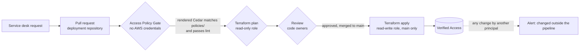

# Approval gate

Access follows a two stage model: a tenant provisions its service, and only the platform team wires up access to it. A tenant cannot expose its own service.

## Where the gate sits and who holds it



| Control | Where | Held by |
| --- | --- | --- |
| Only the platform team can create endpoints | Endpoints live in the network account; tenants have no access there, and groups are not shared to tenant accounts | Platform team |
| Every change is a pull request | Deployment repository; the pipeline role can only apply from `main` | Platform team |
| Review is mandatory | `CODEOWNERS` plus branch protection on `main` (require code owner review, require the gate and plan checks, no bypass) | Code owners (the platform team) |
| The effective policy is reviewed, not just the intent | `policies/*.cedar` must match what the module renders, or the gate fails | Reviewer |
| Unsafe policies cannot be merged | Cedar lint rules L1 to L7 (parse, no unscoped permit, owner and justification, device context on sensitive endpoints) | The pipeline |
| Changes outside the pipeline are detected | EventBridge rule on Verified Access write APIs by any principal other than the pipeline role, to the alarm topic | Platform team (alert recipients) |

> **Branch protection must be enabled** on the deployment repository's `main`. Without it, anyone with write access can push to `main` and the pipeline applies the change unreviewed.

## Audit trail for one approval

1. **Request:** the service desk ticket (who asked, why).
2. **Pull request:** the author, the reviewers and approvals, the tfvars change (intent) and the `policies/*.cedar` diff (effect), with the plan as a comment.
3. **Pipeline run:** the gate result, the plan and the apply log, linked from the merge commit.
4. **CloudTrail:** `ModifyVerifiedAccessGroupPolicy` (and similar) by the pipeline role, with the time it took effect.
5. **Access logs:** every allowed and denied attempt afterwards, with the user and their groups.

## A worked example

Revoking a group's access and granting another: the author changes `identity_groups` in the deployment repository's tfvars. The gate **fails** until the reviewed copy in `policies/` is updated, so the pull request shows the exact effect:

```diff
 permit(principal, action, resource)
 when {
   (
-    context.idc.groups has "11111111-1111-1111-1111-111111111111"
+    context.idc.groups has "22222222-2222-2222-2222-222222222222"
   )
 };
```

After review and merge the pipeline applies it; in testing, changes took effect within about 10 minutes, and a user outside the new group was denied.

## The escape hatch (raw Cedar)

When the structured input cannot express a rule:

1. Write `policies/raw/<name>.cedar` in the deployment repository and reference it as `raw_policy = { cedar = file(...), owner = "...", justification = "..." }`.
2. Lint still runs (a raw policy cannot contain an unscoped permit), and rule L6 lists every raw policy in the job summary.
3. `CODEOWNERS` on `/policies/raw/` requires the security reviewers' approval.
4. The pull request template asks why the structured interface was not enough; repeated needs become structured features.

## Optional organisation guardrail

A service control policy denying `ec2:CreateVerifiedAccessEndpoint` and `ec2:ModifyVerifiedAccess*` outside the network account (or for principals other than the pipeline role) makes the gate impossible to bypass even for account administrators.
