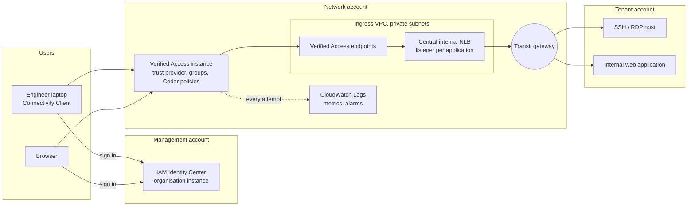
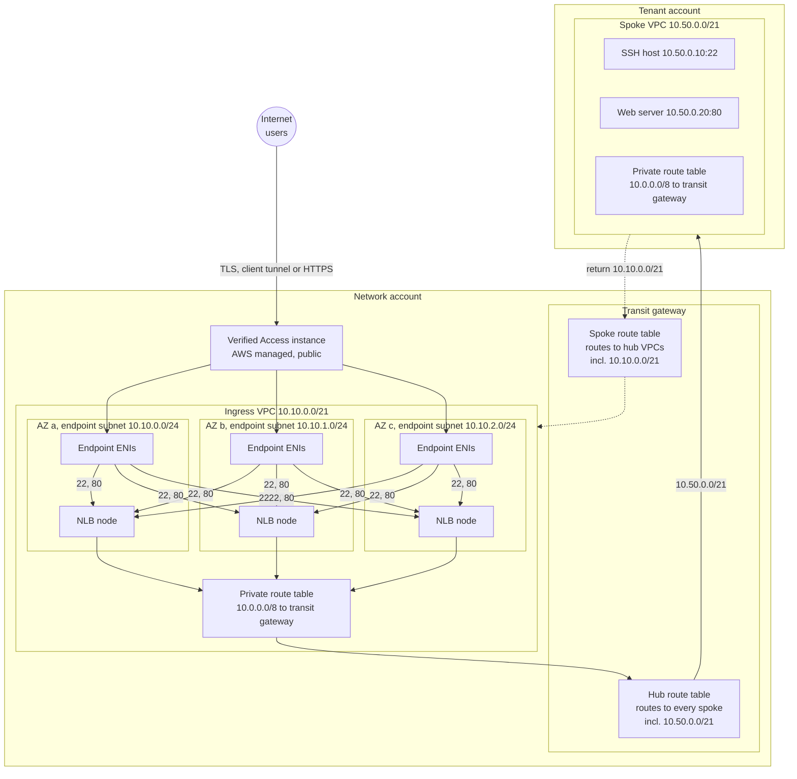
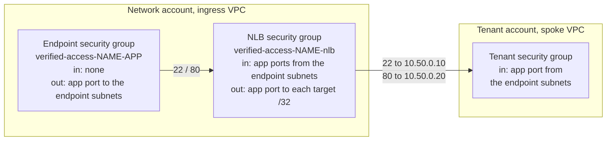
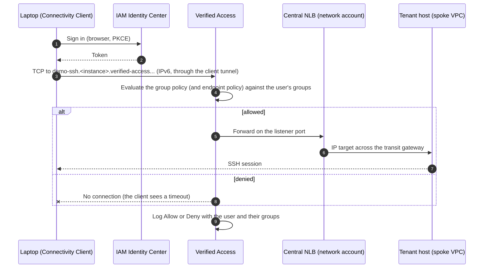
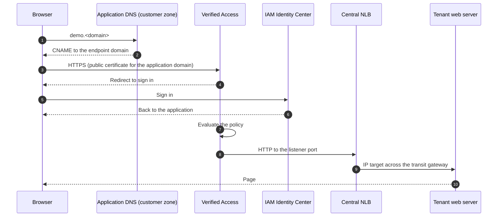

# Architecture

AWS Verified Access gives users access to private applications without a bastion host, a hosted workstation or a VPN. Each request is checked against the user's identity (and optionally their device) at the point of access, and every attempt is logged.

This page describes the recommended design for a hub-and-spoke landing zone, how traffic flows for each type of access, and why. The decisions that are expensive to reverse are recorded as [ADRs](adr/). The design has been proven end to end (SSH through the Connectivity Client and HTTPS in the browser, to services in spoke VPCs across a transit gateway).

## The three layers

| Layer | Where | Changed per customer? |
| --- | --- | --- |
| **Module** | `appvia/terraform-aws-verified-access` (this repository) | Never. Every customer specific value is an input |
| **Deployment** | One repository per customer, from `appvia/terraform-aws-pipeline-template` | Yes: accounts, VPC, central load balancer, alarms, the policy gate |
| **Values** | `values/<environment>.tfvars` in the deployment repository | Yes: who can reach what |

A feature that only makes sense for one customer's topology goes in the deployment repository, never the module.

## Where everything lives

| Component | Placement | Why |
| --- | --- | --- |
| Verified Access instance, trust providers, groups | Network account, one instance per environment | The platform team owns access ([ADR 0001](adr/0001-endpoints-in-network-account.md)); Identity Center must be an organisation instance in the same region |
| Verified Access endpoints | Network account, **dedicated subnets** (for example in the ingress VPC, or a dedicated VPC attached like the ingress VPC) | Tenants cannot create their own endpoints (the approval gate) |
| Central internal NLB | Network account, same subnets as the endpoints | Endpoints only reach load balancers and addresses in their own VPC; the NLB reaches tenants across the transit gateway with IP targets ([ADR 0002](adr/0002-central-nlb-for-tenant-services.md)) |
| Tenant services | Tenant accounts, private subnets, no public addresses | Unchanged; the tenant security group allows the endpoint subnets |
| Access logs, metrics, alarms | Network account, CloudWatch (production: plus S3 in the log archive account) | See [logging](logging.md) and [observability](observability.md) |

## Network design

A hub without inspection. **Addresses are examples.**

| Hop | Route | Notes |
| --- | --- | --- |
| Endpoint to NLB | Local, inside the ingress VPC | Endpoints can only reach load balancers and addresses in their own VPC (finding F4) |
| NLB to tenant | Endpoint subnet route table `10.0.0.0/8` to the transit gateway; the hub attachment uses a route table with a route to every spoke | IP targets outside the VPC are registered with availability zone `all` |
| Tenant back to NLB | Spoke route table `10.0.0.0/8` to the transit gateway; the spoke attachment's route table has the hub VPC's range | Spokes cannot reach each other; they can reply to the ingress VPC |
| New spokes | Associated with the spoke route table and propagated into the hub route table | With auto acceptance and propagation, no hub change is needed to onboard a tenant |

### Security groups

Security groups cannot reference each other across a transit gateway, so the tenant side allows the **endpoint subnet ranges**.

Every rule is scoped to one port and one destination: an endpoint can only reach the load balancer on its application's port, and the load balancer can only reach the registered targets.

### With an inspection VPC

**Recommendation: inspect.** With a central network firewall, associate the transit gateway attachment of the VPC holding the endpoints and the NLB with the inspection route table, so traffic to tenants passes the firewall like any other east-west traffic: one setting in the connectivity configuration, no change to Verified Access. The firewall must allow the endpoint subnets to the tenant ports. This path is validated by routing analysis, not tested.

## Alongside the existing ingress path

Public services keep their existing path (for example CloudFront, AWS WAF, the network firewall and a shared public load balancer, then the transit gateway to the tenant). Verified Access is a **separate path for the workforce**, so it neither duplicates nor bypasses that path:

| | Public ingress | Verified Access |
| --- | --- | --- |
| Who | Anyone on the internet (customers, the public) | Signed in staff, per identity group |
| What | Public applications | Private administration and internal applications (SSH, RDP, databases, internal web tools) |
| Edge | CloudFront, WAF, public load balancer | Verified Access, with an internal NLB (no public load balancer, no public address on any tenant service) |
| Controls | WAF rules, firewall | Cedar policy per request, identity (and optionally device), plus the same firewall when inspection is in place |

Rules that keep them separate: never point a Verified Access endpoint at a public load balancer, and never expose an internal application publicly to make it reachable; use a Verified Access endpoint instead. For HTTP endpoints, Verified Access can also be associated with an AWS WAF web ACL if application layer filtering is needed.

## Traffic paths

### TCP (SSH, RDP, databases) through the Connectivity Client

- The endpoint name resolves to an **IPv6 address only** and works only while the Connectivity Client is connected.
- The client is available for **macOS and Windows only**; it needs a configuration file exported from the instance (see the [runbook](runbook.md)).
- Proven: SSH from a laptop to a host in a spoke VPC.

### HTTP and HTTPS in the browser (no client)

Users always connect to Verified Access over **HTTPS**; Verified Access then talks to the application over HTTP or HTTPS (the endpoint `protocol`). Proving HTTPS to the user with HTTP to the application covers both.

- Needs a **public ACM certificate** for the application domain in the network account, and a CNAME from the application domain to the endpoint domain in whichever DNS the customer runs. The module takes both as inputs and creates neither.
- HTTP endpoints work through the central **NLB** (a TCP listener); an ALB is not needed.
- Proven: a page served from a private instance in a spoke VPC, with no public address.

### Denied access

A user who signs in but is not in a permitted group is denied by the Cedar policy before any traffic reaches the load balancer. TCP clients see a timeout; browsers see a 403 page. The access log records the decision, the user and their groups, which is how a denial is investigated (see the [runbook](runbook.md)).

## Endpoint types in scope

| Type | Covers | In scope | Notes |
| --- | --- | --- | --- |
| `load-balancer` | Any tenant service, TCP or HTTP | **Yes, the default** | Fronts the central NLB, which reaches tenants across the transit gateway |
| `network-interface` | A service on an ENI in the network account | Supported | Same-VPC only, so rarely useful for tenants |
| `cidr` | SSH, RDP by address range | Supported, **not for tenants** | Only reaches addresses **inside the endpoint's own VPC**; a tenant address across the transit gateway is rejected (`InvalidParameterValue`). Use `load-balancer` instead |
| `rds` | RDS instances, clusters, proxies | Supported | Same-VPC behaviour unproven; tenant databases can be reached as TCP through the NLB |

## Trust providers

| Provider | Supported by the module | Notes |
| --- | --- | --- |
| IAM Identity Center | Yes (organisation instance, same region) | Proven in testing; the recommended choice where Identity Center is already the workforce directory |
| OIDC (Okta, Entra ID, Google and others) | Yes | Group names in the `groups` claim; add the `offline_access` scope for the Connectivity Client |
| Device: Jamf, CrowdStrike, JumpCloud | Yes, optional; `sensitive` endpoints require it (fail closed) | Untested. Device context for **TCP** endpoints is unconfirmed by AWS documentation (risk R1): test with the provider before marking TCP endpoints sensitive |

Identity group membership is the control. The verified email condition is **off by default**: IAM Identity Center can report `email.verified = false` for every user (for example when users are provisioned from an external directory), and requiring it then denies everyone. Turn it on only where the directory verifies emails ([ADR 0003](adr/0003-identity-center-groups-as-the-control.md)).

## Inspection (hub with a network firewall)

The design is the same with an inspection VPC: the hub VPC's transit gateway attachment decides whether the leg to the tenant is inspected. This path is validated by routing analysis only, not tested.

## Quotas and grouping

Default quotas per account and region (all adjustable): 5 instances, 10 groups, 15 trust providers, **50 endpoints**. One NLB supports 50 listeners.

| Tenants | Applications each | Endpoints | Within the default? |
| --- | --- | --- | --- |
| 10 | 2 | 20 | Yes |
| 25 | 2 | 50 | At the limit: raise the quota first |
| 50 | 3 | 150 | Raise the endpoint quota; add a second NLB (listeners) |

**Grouping strategy:** a group is a set of endpoints sharing one policy, so create groups per **audience** (for example platform engineers, tenant developers, support), not per tenant. Tenant specific rules go in endpoint policies. This keeps well within the 10 group limit as tenants grow.

## Requesting access

1. The tenant raises a service desk request: the service, its private address and port, and who needs access.
2. A platform engineer opens a pull request in the deployment repository: the endpoint, the load balancer target and the group, with the rendered Cedar in `policies/`.
3. The policy gate and plan run; the platform team reviews and merges; the pipeline applies.
4. The service desk ticket links the pull request, which is the audit trail. See the [approval gate](approval-gate.md).
