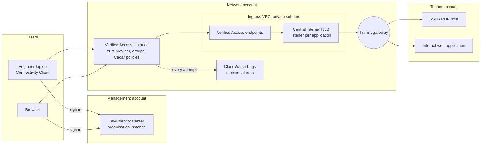
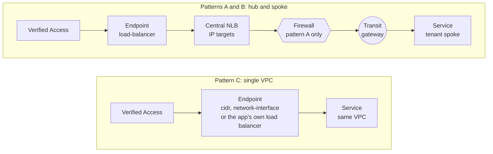
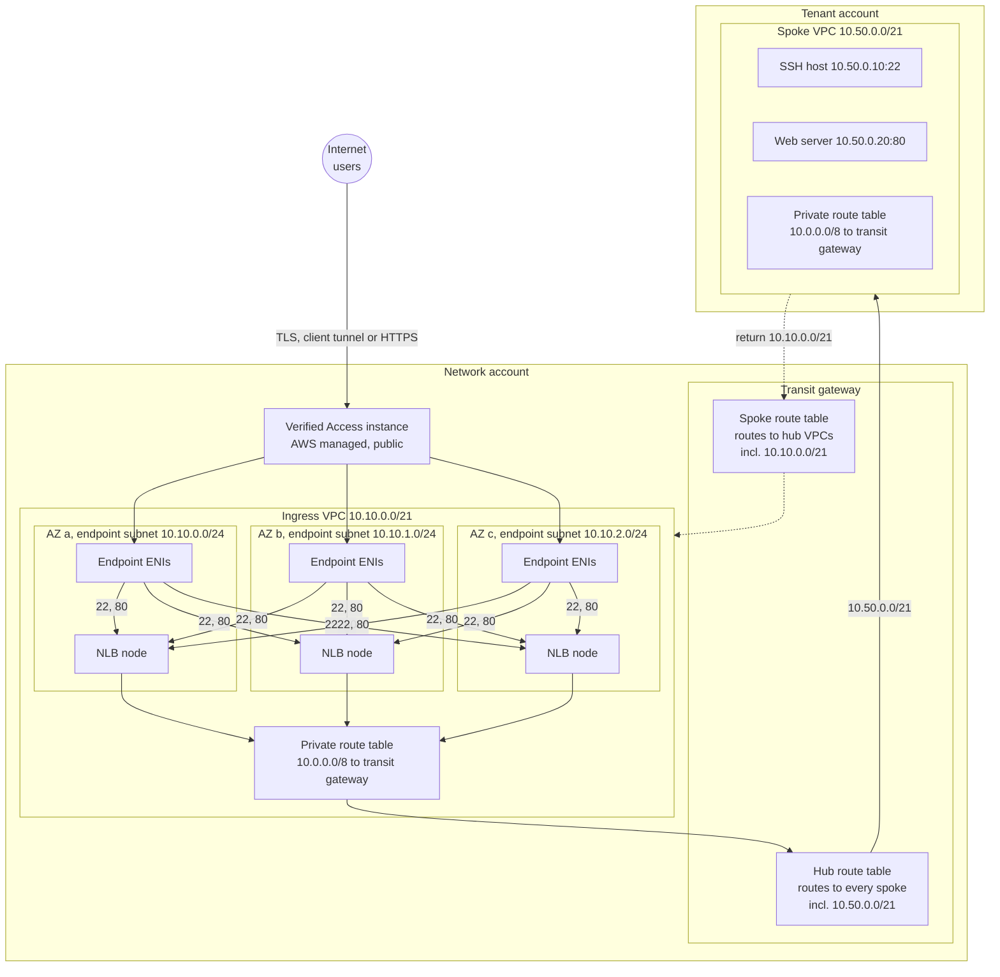
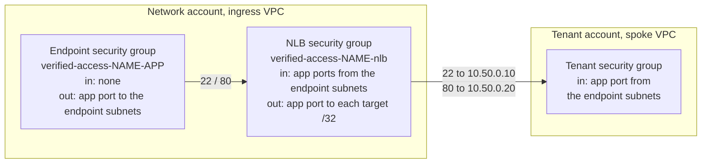
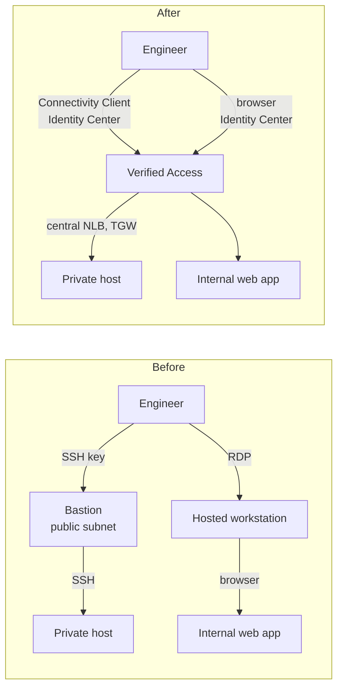
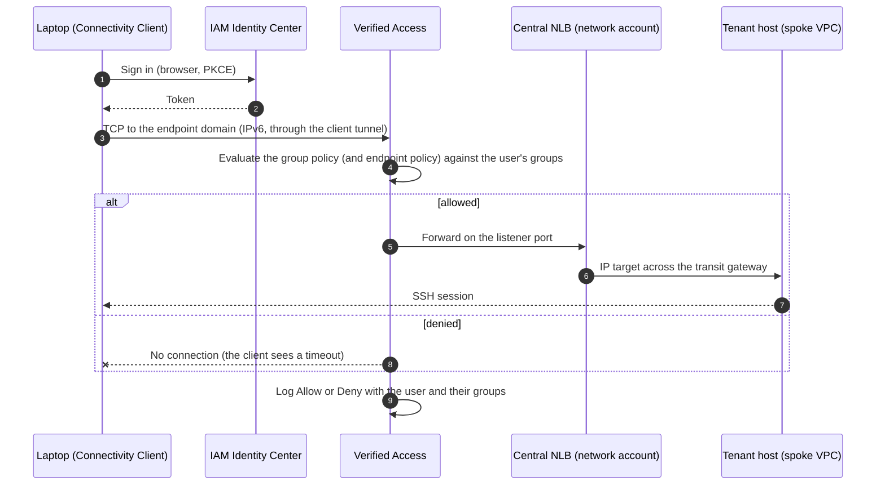
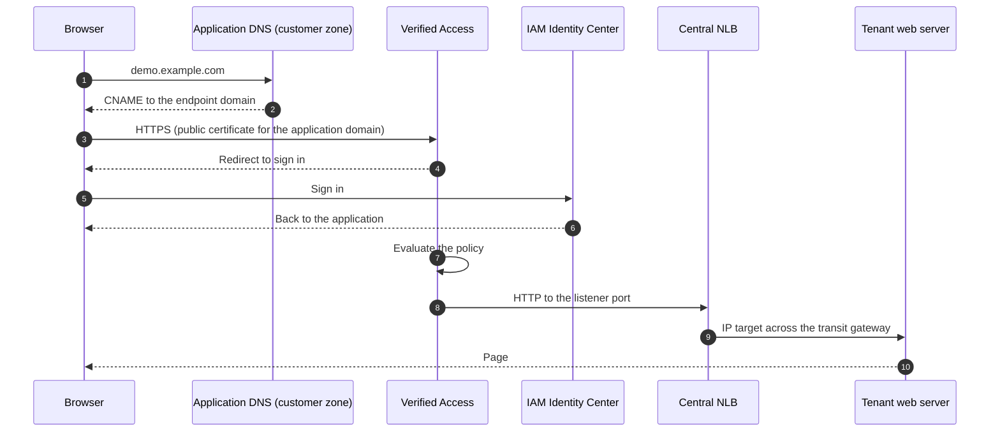

# How it works

AWS Verified Access gives users access to private applications without a bastion host, a hosted workstation or a VPN. Each request is checked against the user's identity (and optionally their device) at the point of access, and every attempt is logged.

This page holds every diagram and network explanation for the module: the components, where they live, how traffic flows for each type of access, which topology to choose, what to check on a firewall, the quotas and the limitations. The decisions that are expensive to reverse are recorded as [ADRs](adr/). The design has been proven end to end (SSH through the Connectivity Client and HTTPS in the browser, to services in spoke VPCs across a transit gateway).

New to the module? Start with [getting started](getting-started.md).

- [The three layers](#the-three-layers)
- [Where everything lives](#where-everything-lives)
- [Supported topologies](#supported-topologies) and [do I need the central NLB?](#do-i-need-the-central-nlb)
- [Network design](#network-design), [security groups](#security-groups) and [inspection](#with-an-inspection-vpc)
- [Alongside the existing ingress path](#alongside-the-existing-ingress-path) and [compared with a bastion](#compared-with-a-bastion)
- [Traffic paths](#traffic-paths): [TCP](#tcp-ssh-rdp-databases-through-the-connectivity-client), [HTTPS](#http-and-https-in-the-browser-no-client), [denied](#denied-access)
- [Endpoint types](#endpoint-types), [trust providers](#trust-providers), [quotas and grouping](#quotas-and-grouping)
- [Create or bring your own](#create-or-bring-your-own): every supporting resource, created by the module or supplied
- [Limitations](#limitations)

## The three layers

| Layer | Where | Changed per customer? |
| --- | --- | --- |
| **Module** | `appvia/terraform-aws-verified-access` (this repository) | Never. Every customer specific value is an input, and every optional component (central load balancer, certificate, alarms, dashboard, metric stream, WAF) is switched on by an input |
| **Deployment** | One repository per customer, from `appvia/terraform-aws-pipeline-template` | Yes: accounts, VPC, the pipeline role, the policy gate, DNS records |
| **Values** | `values/<environment>.tfvars` in the deployment repository | Yes: who can reach what, and which module options are on |

Components every hub-and-spoke customer needs are module options, so a deployment is one module block of values and toggles (self-service). Only what is specific to one customer (DNS hosting, the pipeline, the network itself) stays in the deployment repository. The module consumes an existing network (VPC, dedicated subnets and, for `hub`, a transit gateway) and never creates VPCs or subnets; it creates DNS records only in a Route 53 hosted zone you give it (`dns`).

## Where everything lives

| Component | Placement | Why |
| --- | --- | --- |
| Verified Access instance, trust providers, groups | Network account, one instance per environment | The platform team owns access ([ADR 0001](adr/0001-endpoints-in-network-account.md)); Identity Center must be an organisation instance in the same region |
| Verified Access endpoints | Network account, **dedicated subnets** (for example in the ingress VPC, or a dedicated VPC attached like the ingress VPC) | Tenants cannot create their own endpoints (the [approval gate](security.md#the-approval-gate)) |
| Central internal NLB | Network account, same subnets as the endpoints; created by the module with `topology = "hub"` | Endpoints only reach load balancers and addresses in their own VPC; the NLB reaches tenants across the transit gateway with IP targets ([ADR 0002](adr/0002-central-nlb-for-tenant-services.md)) |
| Tenant services | Tenant accounts, private subnets, no public addresses | Unchanged; the tenant security group allows the endpoint subnets |
| Access logs, metrics, alarms, dashboard | Network account, CloudWatch (production: plus S3 in the log archive account); alarms, dashboard and metric stream are module options | See [logging](security.md#logging) and [operations](operations.md) |

## Supported topologies

The same module serves three topologies; only the deployment around it changes.

| Pattern | Example | Path | Module `topology` | Reference |
| --- | --- | --- | --- | --- |
| **A. Hub with inspection** | A landing zone with a central network firewall | Endpoints and NLB in the hub, transit gateway, **firewall**, tenant spoke | `hub` (central NLB) | This page, with the [inspection](#with-an-inspection-vpc) checklist |
| **B. Hub without inspection** | A landing zone with a transit gateway | Endpoints and NLB in the hub, transit gateway, tenant spoke | `hub` (central NLB) | This page (proven), [`examples/hub`](../examples/hub) |
| **C. Single VPC** | A small estate, or trying the module | Endpoints in the **same VPC** as the services | `single-vpc` (default, no NLB) | [`examples/basic`](../examples/basic) |

### Do I need the central NLB?

| Where is the service? | Endpoint type | NLB |
| --- | --- | --- |
| Same VPC as the endpoints | `cidr` (SSH, RDP by address), `network-interface`, `rds`, or `load-balancer` pointing at the application's own load balancer | **Not needed** |
| Another VPC (spoke behind a transit gateway, or peered) | `load-balancer`, TCP or HTTP | **Needed**: endpoints only reach load balancers and addresses in their own VPC, and a `cidr` endpoint targeting an address in another VPC is rejected |

The NLB is shared: one NLB, one listener port per application, up to 50 listeners. Set `topology = "hub"` and give each `load-balancer` endpoint (TCP or HTTP) the service's IPv4 `targets`. The module then creates the NLB (`<name_prefix>-<name>`, internal, cross-zone, in `subnet_ids`, with its own security group, optionally with fixed private IPs per subnet through `load_balancer.private_ips`), and for every endpoint with `targets` a TCP listener on the application port, an IP target group with TCP health checks, the target registrations (availability zone `all`) and the security group rules, and points the endpoint at the NLB.

Rules worth knowing (all checked at plan time):

- Each endpoint with `targets` needs its own listener port (one listener each, up to 50 per NLB). tcp endpoints use a single port range with `from_port = to_port` and http and https endpoints use `port`: that is the **service port**, which the target group sends to. The **listener port** defaults to the service port; set `listener_port` to put several services on the same service port (for example SSH hosts on 22) behind the NLB. The listener port is also the port the endpoint is configured with, so it is the port TCP users connect to on the endpoint domain ([several hosts on one port](getting-started.md#several-hosts-on-one-port)).
- `target_details` replaces `targets` when a target needs its own port or availability zone (`all`, the default, for addresses across the transit gateway; a zone name for an address inside the hub VPC). `health_check` (TCP on the traffic port by default, or HTTP/HTTPS with a path), `deregistration_delay` (300 seconds), `preserve_client_ip` (off: targets across a transit gateway would reply directly to the endpoint, bypassing the NLB) and `proxy_protocol_v2` (off) tune each target group; `load_balancer.cross_zone_enabled` (on) the NLB.
- The NLB security group needs one inbound rule per listener and subnet range, and one outbound rule per target address and port (a numeric health check port adds one per target). The default quota is 60 rules per direction, so with three subnets about 20 listeners fit; the plan stops before the quota is exceeded. Raise the quota and `load_balancer.max_security_group_rules` together, or target the tenants' own load balancers rather than individual hosts.
- **Naming:** every resource is named `<name_prefix>-<name>-…` (default prefix `verified-access`, for example load balancer `verified-access-production`), so a customer's naming convention is one input, for example `name_prefix = "prod-euw2-va"`; scope pipeline roles to `<name_prefix>-*`. With `hub`, the prefix plus `name` is at most 31 characters (load balancer names are at most 32). Target groups are named `<name_prefix>-<hash>` (a hash of the deployment and endpoint names, the VPC and the target port, with the readable name in the `Name` tag), so endpoint names have no length rule and several deployments can share an account and region; a new target port gives a new name, so the replacement target group is created before the old one is destroyed. The instance, trust providers, groups and endpoints carry `<name_prefix>-<name>[-…]` as their `Name` tag. With `hub`, no endpoint can be named `nlb`.
- Targets must be IPv4 addresses known at plan time (literal addresses: a fixed host address, or ideally the fixed private IPs of the tenant's own internal NLB, so tenant changes do not need a platform change) and must be outside the hub VPC.
- Endpoints with `targets` cannot override `subnet_ids`; they use the module's `subnet_ids`, which hold the central load balancer.
- `targets` without `topology = "hub"` are rejected. An endpoint can still bring its own load balancer with `load_balancer_arn` instead of `targets` (not both).
- Changing `load_balancer.private_ips` replaces the load balancer. `load_balancer.enable_deletion_protection` protects it from deletion, and `load_balancer.tcp_idle_timeout_seconds` (60 to 6000, default 350) sets the TCP listener idle timeout.

## Network design

A hub without inspection. **Addresses are examples.**

| Hop | Route | Notes |
| --- | --- | --- |
| Endpoint to NLB | Local, inside the ingress VPC | Endpoints can only reach load balancers and addresses in their own VPC (finding F4) |
| NLB to tenant | Endpoint subnet route table `10.0.0.0/8` to the transit gateway; the hub attachment uses a route table with a route to every spoke | IP targets outside the VPC are registered with availability zone `all` |
| Tenant back to NLB | Spoke route table `10.0.0.0/8` to the transit gateway; the spoke attachment's route table has the hub VPC's range | Spokes cannot reach each other; they can reply to the ingress VPC |
| New spokes | Associated with the spoke route table and propagated into the hub route table | With auto acceptance and propagation, no hub change is needed to onboard a tenant |

### Security groups

Security groups cannot reference each other across a transit gateway, so the tenant side allows the **endpoint subnet ranges**.

Every rule is scoped to one port and one destination: an endpoint can only reach the load balancer on its application's port, and the load balancer can only reach the registered targets. The module creates both security groups by default (or uses yours, see [create or bring your own](#create-or-bring-your-own)); the NLB security group allows the endpoint **subnet ranges** rather than the endpoint security groups, which would form a dependency cycle. For `load-balancer`, `network-interface` and `rds` endpoints whose target range cannot be derived, the endpoint security group may send to the address ranges of the VPC (`vpc_id`, read with `ec2:DescribeVpcs`; these endpoints only reach targets in their own VPC), or to `allowed_egress_cidr_blocks` when set, or per endpoint to `egress_cidr_blocks`. A `cidr` endpoint sends only to its `cidr`, and an endpoint with `targets` only to the module subnets, which hold the central NLB.

### With an inspection VPC

**Recommendation: inspect.** The design is the same with an inspection VPC: the hub VPC's transit gateway attachment decides whether the leg to the tenant is inspected. With a central network firewall, associate the transit gateway attachment of the VPC holding the endpoints and the NLB with the inspection route table, so traffic to tenants passes the firewall like any other east-west traffic: one setting in the connectivity configuration, no change to Verified Access. This path is validated by routing analysis, not tested.

Verified Access does not depend on the firewall, but a firewall that is not prepared for this traffic breaks it. Check:

| Check | Why |
| --- | --- |
| **Rules allow the endpoint and NLB subnets to the tenant ports** (for example 22, 80) | The NLB sends from its own addresses in the hub subnets, so the firewall sees "hub subnet to tenant port". Without a rule the traffic is dropped, and users see a timeout that looks like a policy denial |
| **Symmetric routing**: appliance mode on the inspection VPC's transit gateway attachment | A stateful firewall drops replies it did not see leave; asymmetric paths through different firewall endpoints break connections |
| **NLB health checks are allowed** on the same ports | Blocked health checks mark targets unhealthy, fire the NLB alarms and stop forwarding |
| **Idle timeouts** are aligned | Firewalls expire idle flows too (AWS Network Firewall: 350 seconds by default); keep SSH keep alives |

What the firewall adds, and does not: it enforces which hub subnets reach which tenant ports, on top of Verified Access. It cannot see the user (only the NLB's address; identity is enforced by Verified Access first), and it cannot inspect SSH or TLS content, only addresses and ports.

## Alongside the existing ingress path

Public services keep their existing path (for example CloudFront, AWS WAF, the network firewall and a shared public load balancer, then the transit gateway to the tenant). Verified Access is a **separate path for the workforce**, so it neither duplicates nor bypasses that path:

| | Public ingress | Verified Access |
| --- | --- | --- |
| Who | Anyone on the internet (customers, the public) | Signed in staff, per identity group |
| What | Public applications | Private administration and internal applications (SSH, RDP, databases, internal web tools) |
| Edge | CloudFront, WAF, public load balancer | Verified Access, with an internal NLB (no public load balancer, no public address on any tenant service) |
| Controls | WAF rules, firewall | Cedar policy per request, identity (and optionally device), plus the same firewall when inspection is in place |

Rules that keep them separate: never point a Verified Access endpoint at a public load balancer, and never expose an internal application publicly to make it reachable; use a Verified Access endpoint instead. For HTTP endpoints, the module can associate an AWS WAF web ACL with the instance (`waf`: an existing web ACL with `web_acl_arn`, or one created with `create = true` using the AWS common, known bad inputs and IP reputation rule groups). WAF only applies to HTTP endpoints, and with IAM Identity Center it inspects requests **before** sign-in, so it also filters unauthenticated traffic.

## Compared with a bastion

Before and after moving a tenant off a bastion and a hosted workstation ([moving from bastions](getting-started.md#moving-from-bastions-and-jump-boxes)):

## Traffic paths

### TCP (SSH, RDP, databases) through the Connectivity Client

- The endpoint name (for example `demo-ssh.INSTANCE.prod.verified-access.REGION.amazonaws.com`, from the `endpoint_domains` output) resolves to an **IPv6 address only** and works only while the Connectivity Client is connected.
- The client is available for **macOS and Windows only**; it needs a configuration file exported from the instance (see [connect over TCP](operations.md#connect-over-tcp-ssh-rdp-databases)).
- Proven: SSH from a laptop to a host in a spoke VPC.

### HTTP and HTTPS in the browser (no client)

Users always connect to Verified Access over **HTTPS**; Verified Access then talks to the application over HTTP or HTTPS (the endpoint `protocol`). Proving HTTPS to the user with HTTP to the application covers both.

- Needs a **public ACM certificate** for the application domain in the network account, and a CNAME from the application domain to the endpoint domain in whichever DNS the customer runs. The module can request a DNS validated wildcard certificate (`certificate = { domain_name = "example.com" }` covers `*.example.com`, so application domains must be one level below it, for example `app.example.com`) and exports the validation records (`certificate_validation_records`); the DNS records stay with the customer's DNS, wherever it is hosted, unless it is a Route 53 public hosted zone the module may publish them in (`dns = { zone_id = "..." }`). An endpoint can still bring its own `domain_certificate_arn`.
- HTTP endpoints work through the central **NLB** (a TCP listener); an ALB is not needed.
- Proven: a page served from a private instance in a spoke VPC, with no public address.

### Denied access

A user who signs in but is not in a permitted group is denied by the Cedar policy before any traffic reaches the load balancer. TCP clients see a timeout; browsers see a 403 page. The access log records the decision, the user and their groups, which is how a denial is investigated (see [troubleshooting](operations.md#troubleshooting) and [what a log event tells you](security.md#what-a-log-event-tells-you)).

## Endpoint types

| Type | Covers | In scope | Notes |
| --- | --- | --- | --- |
| `load-balancer` | Any tenant service, TCP or HTTP | **Yes, the default** | Fronts the central NLB, which reaches tenants across the transit gateway |
| `network-interface` | A service on an ENI in the network account | Supported | Same-VPC only, so rarely useful for tenants |
| `cidr` | SSH, RDP by address range | Supported, **not for tenants** | Only reaches addresses **inside the endpoint's own VPC**; a tenant address across the transit gateway is rejected (`InvalidParameterValue`). Use `load-balancer` instead. `cidr_endpoints_custom_subdomain` gives them a custom subdomain, delegated to the `name_servers` output |
| `rds` | RDS instances, clusters, proxies | Supported | Same-VPC behaviour unproven; tenant databases can be reached as TCP through the NLB |

`cidr` and `rds` endpoints are TCP only. http and https endpoints need an `application_domain` and either `domain_certificate_arn` or the module `certificate`.

## Trust providers

| Provider | Supported by the module | Notes |
| --- | --- | --- |
| IAM Identity Center | Yes (organisation instance, same region) | Proven in testing; the recommended choice where Identity Center is already the workforce directory |
| OIDC (Okta, Entra ID, Google and others) | Yes | Group names in the `groups` claim, or another claim with `oidc.groups_claim` (a dotted path reaches a nested claim); add the `offline_access` scope for the Connectivity Client. The Connectivity Client can use a separate native application client (`native_client_id`, `native_scope`, `oidc_native_client_secret`) |
| Device: Jamf, CrowdStrike, JumpCloud | Yes, optional; `sensitive` endpoints require it (fail closed) | Untested. Device context for **TCP** endpoints is unconfirmed by AWS documentation (risk R1): test with the provider before marking TCP endpoints sensitive |

Identity group membership is the control; see [identity](security.md#identity) for the verified email condition.

## Quotas and grouping

Default quotas per account and region (all adjustable): 5 instances, 10 groups, 15 trust providers, **50 endpoints**. One NLB supports 50 listeners.

| Tenants | Applications each | Endpoints | Within the default? |
| --- | --- | --- | --- |
| 10 | 2 | 20 | Yes |
| 25 | 2 | 50 | At the limit: raise the quota first |
| 50 | 3 | 150 | Raise the endpoint quota; add a second NLB (listeners) |

**Grouping strategy:** a group is a set of endpoints sharing one policy, so create groups per **audience** (for example platform engineers, tenant developers, support), not per tenant. Tenant specific rules go in endpoint policies (`endpoints.<name>.policy`, which narrows the group's audience to some of its identity groups or adds conditions; Verified Access requires both the group and the endpoint policy to allow). This keeps well within the 10 group limit as tenants grow.

## Create or bring your own

Every supporting resource follows one rule: the module creates it (`create = true`, or `create_<thing> = true` where one input holds several resources), **or** you give it yours (an ARN, id or name), never both; the plan fails when both or neither are set. Where the module creates a resource by default (the log group, the alarm topic, the security groups), its flag defaults to `true`, and using yours means setting it to `false`. Where yours is named by a name rather than an ARN (`bucket_name`, `delivery_stream_name`, `log_group_name`), the same name also names the resource the module creates.

| Resource | Create | Use existing | Default | Notes |
| --- | --- | --- | --- | --- |
| Verified Access instance, user and device trust providers, logging configuration | `user_trust_provider` (and `device_trust_provider`, `access_logs`) | `existing_instance = { id, user_policy_reference_name, ... }` | Created | With an existing instance the module creates only groups, endpoints and (`hub`) the central NLB; the instance, trust providers, logging and web ACL belong to its owner, so `user_trust_provider`, `device_trust_provider`, `access_logs` (and the alarms, dashboard and metric stream that need it), `waf`, `fips_enabled`, `description`, `cidr_endpoints_custom_subdomain` and the OIDC secrets must be unset. `existing_instance` describes the attached trust providers (type, policy reference names, groups claim, device settings) so the policies render exactly as they would for providers the module created |
| KMS key for trust providers, groups and endpoints | `create_kms_key = true` (`alias/<name_prefix>-<name>`, rotation on) | `kms_key_arn` | None (AWS owned keys) | The created key permits use only via `verified-access.<region>.amazonaws.com` by callers in this account, as [AWS documents](https://docs.aws.amazon.com/verified-access/latest/ug/encryption-at-rest.html). Deleting the key makes the encrypted configuration unreadable, so it has a 30 day deletion window |
| CloudWatch log group | `access_logs.cloudwatch = {}` (`create = true`) | `access_logs.cloudwatch = { create = false, log_group_name = "..." }` | Created | Created log group: `/aws/<name_prefix>/<name>` (or `log_group_name`). An existing log group's retention and encryption are owned elsewhere |
| KMS key for the log group | `access_logs.cloudwatch.create_kms_key = true` | `access_logs.cloudwatch.kms_key_arn` | None (CloudWatch Logs encryption) | Created key: usable by `logs.<region>.amazonaws.com` only for the access log group (encryption context condition); only for a log group the module creates |
| S3 access log bucket | `access_logs.s3 = { create = true }` | `access_logs.s3 = { bucket_name = "...", bucket_owner = "..." }` | Off | Created bucket: `<name_prefix>-<name>-access-logs-<account id>` (or `bucket_name`), versioned, SSE-S3 or `kms_key_arn`, public access blocked, ACLs disabled, TLS only, lifecycle expiry (`retention_days`, default 365), optional `object_lock` (irreversible, see [operations](operations.md#tear-down)) and a policy permitting Verified Access log delivery from this account |
| Firehose delivery stream for access logs | `access_logs.firehose = { create = true, destination_bucket_arn = "..." }` | `access_logs.firehose = { delivery_stream_name = "..." }` | Off | Created stream: `<name_prefix>-<name>-access-logs` (or `delivery_stream_name`), S3 destination only (GZIP), with its own IAM role; `destination_bucket_arn`, `prefix`, `kms_key_arn` and buffering apply only to it. Other destinations (HTTP endpoints, Splunk, OpenSearch) need a stream you create |
| Endpoint security group | `create_security_group = true` per endpoint | `create_security_group = false` plus `security_group_ids` | Created | Supplied groups must allow the endpoint to reach its targets (and, for endpoints with `targets`, the central NLB on the listener port) |
| Central NLB security group (`hub`) | `load_balancer.create_security_group = true` | `create_security_group = false` plus `load_balancer.security_group_ids` | Created | Supplied groups must allow the endpoint subnets in on every listener port and the targets out on their target and health check ports; the module adds no rules to them. With `create_security_group = true`, `security_group_ids` are attached as well |
| Metric stream IAM role | `metric_stream.create_role = true` | `metric_stream.role_arn` | (one is required) | Created role: trusted by `streams.metrics.cloudwatch.amazonaws.com` in this account, may only `firehose:PutRecord` and `PutRecordBatch` on `firehose_arn` |
| Alarm SNS topic and its key | `alarms = {}` (`create_sns_topic = true`), `alarms.create_kms_key = true` | `alarms = { create_sns_topic = false, sns_topic_arn = "..." }`, `alarms.kms_key_arn` | Topic created, unencrypted | See [operations](operations.md#alarms) |
| WAF web ACL | `waf = { create = true }` | `waf = { web_acl_arn = "..." }` | Off | |
| Wildcard certificate | `certificate = { domain_name = "..." }` | `domain_certificate_arn` per endpoint | Off | |
| Route 53 hosted zone | Not offered | `dns = { zone_id = "..." }` | Off | Existing only: a public zone is usually shared with other records and delegated from a registrar or parent zone, so creating and destroying it with the module would be unsafe |
| Network (VPC, subnets, transit gateway) | Not offered | `vpc_id`, `subnet_ids` | | The module consumes the network and never creates it |

**A log archive in another account:** the module deploys to one account, so it cannot create a bucket in a central log archive account. Pass that bucket by name (`access_logs.s3 = { bucket_name = "...", bucket_owner = "<log archive account id>" }`); its policy, retention and Object Lock are owned by the log archive account, and its policy must permit log delivery from this account (the same `delivery.logs.amazonaws.com` statements the created bucket carries, with this account as `aws:SourceAccount`). Use `create = true` for a bucket in the same account as Verified Access.

## Limitations

What to know before choosing Verified Access, and what the design around it implies. Workarounds are noted where they exist. Limitations of the policy language (one policy document per group and endpoint, no schema validation, context per provider and protocol) are in [access policies](policies.md#limitations-and-gotchas).

### Verified Access itself

These are properties of the AWS service; the module cannot change them.

| Limitation | Impact | Workaround |
| --- | --- | --- |
| **No Linux Connectivity Client** (macOS and Windows only) | Linux users cannot use TCP endpoints (SSH, RDP, databases) | Another (managed) access route for Linux users, or a supported desktop |
| **No CloudWatch metrics of its own** | Every metric is derived from the access logs, which arrive about 3 to 5 minutes after the attempt, so alarms lag | Log derived metrics and alarms ([operations](operations.md#log-derived-metrics)) |
| **Policy changes take about 5 to 10 minutes** to take effect | Granting and revoking access is not instant, including in an emergency | Plan for the delay in the access request process |
| **A new endpoint takes about 17 minutes** to become active | Onboarding an application is slow to apply | Batch onboarding; the pipeline waits |
| **HTTP requests longer than 60 seconds** return 504 | Long running web requests fail | Change the application, or keep it on another route |
| **TCP and HTTP only** (no UDP or other protocols) | Some protocols are not supported | Another route |
| **FIPS endpoints in US, Canada and GovCloud (US) regions only** | `fips_enabled` elsewhere is rejected by AWS (the module warns); changing it replaces the instance | Choose the region first |
| **TCP endpoint names resolve to IPv6 only** and work only while the Connectivity Client is connected | "Could not resolve hostname" when the client is disconnected | See [troubleshooting](operations.md#troubleshooting) |
| **A denied TCP connection looks like a timeout** to the user | Users cannot tell denied from broken | Check the access logs (`denied-requests` query) |
| **Priced per application** (about $146 a month per TCP endpoint, $197 per HTTP application) | Cost grows with the number of applications, unlike one shared bastion | Keep endpoints to what is needed; several ports of one service on one TCP endpoint ([cost](cost.md)) |
| **Quotas** per account and region: 50 endpoints, 10 groups, 5 instances, 15 trust providers (adjustable) | Large estates need quota increases | Group by audience, not tenant ([quotas and grouping](#quotas-and-grouping)) |
| **For people, not automation** | Jobs and service accounts that used a bastion (for example CI jobs) need another route | AWS Systems Manager, PrivateLink or pipeline roles |
| **Permissions are under documented** | Creating an endpoint needs `sso:PutApplicationAssignmentConfiguration`, missing from AWS's documented permissions; exporting the client configuration needs `ec2:ExportVerifiedAccessInstanceClientConfiguration` | Grant the Identity Center application configuration actions to the deploying role; export the configuration with the pipeline role |

### Consequences of the design

These follow from placing Verified Access centrally in a hub-and-spoke network.

| Limitation | Impact | Workaround |
| --- | --- | --- |
| **Endpoints only reach their own VPC**; a `cidr` endpoint cannot target an address across a transit gateway | Every service in a spoke needs the **central NLB**: an extra hop and component | One shared NLB ([ADR 0002](adr/0002-central-nlb-for-tenant-services.md)); single VPC estates do not need it |
| **One NLB listener port per application**, up to 50 per NLB | Port planning; a second NLB beyond 50 applications | Allocate ports per application; add NLBs as needed |
| **NLB targets are fixed IP addresses** | A changed tenant address needs a platform change | Target the tenant's own private load balancer, whose addresses are stable |
| **HTTPS needs a public certificate and DNS** for each domain, in the network account, validated wherever the domain is hosted | The DNS owner is involved once per domain | One wildcard certificate per environment domain (module option `certificate`, which exports the validation records) |
| **Access depends on the identity provider and Verified Access** | If either is unavailable, nobody gets in | Keep a documented break glass route (for example Systems Manager Session Manager with approval) |
| **Idle TCP sessions drop** after the load balancer idle timeout (350 seconds) | SSH sessions disconnect when idle | SSH keep alives (`ServerAliveInterval 60`) or a longer listener idle timeout (`load_balancer.tcp_idle_timeout_seconds`) |

### Not supported by AWS

Requests that come up but that Verified Access (or the AWS API and provider) cannot do, so the module cannot offer them:

- **UDP or any other non-TCP protocol** (DNS, syslog, QUIC, multicast).
- **Time-of-day or schedule conditions in Cedar**: the request context carries no time, so "only during office hours" cannot be written as a policy.
- **Private CA certificates** for application domains: the `domain_certificate_arn` must be a public ACM certificate.
- **More than one user trust provider per instance**: one identity provider per instance; a second directory needs a second instance (a second deployment of the module).
- **The Connectivity Client configuration as a Terraform resource**: it is only exported with `aws ec2 export-verified-access-instance-client-configuration` (output `client_configuration_command`).
- **Instance ID targets on the NLB across a transit gateway**: targets in another VPC must be IP targets (availability zone `all`).
- **Keeping the OIDC client secret out of Terraform state**: the trust provider takes the secret as an argument, so it is stored in state; encrypt and restrict the state.

### Roadmap

Not built yet, in no particular order. Ask if one matters to you:

- Several device trust providers on one instance.
- Groups shared to other accounts with AWS RAM.
- More than 50 load balanced applications by sharding endpoints across several NLBs.
- Endpoint security group egress to managed prefix lists, and IPv6.
- NLB access logs and TLS listeners.
- Custom WAF rules and WAF logging on the created web ACL.
- Certificate subject alternative names and application domains deeper than one level below the certificate domain.
- Structured helpers for break glass access, email domain and client IP conditions (today: `additional_conditions` or `raw_policy`).
- A module built ALB for HTTP applications.
- Configurable resource timeouts.
- A `region` input using the AWS provider v6 per-resource `region` argument, so one provider can deploy to several regions. Today an instance is regional: call the module once per region, each with a provider for that region.
- More examples: OIDC with Okta and CrowdStrike, an RDS or Aurora endpoint, team-based groups.

### Not yet proven

| Item | Status |
| --- | --- |
| Device posture (Jamf, CrowdStrike, JumpCloud) on **TCP** endpoints | Not confirmed by AWS documentation; test with the provider before marking TCP endpoints `sensitive` |
| Whether revoking access ends an **active** session | New connections are denied after a revoke; active sessions untested |
| The path through an inspection VPC | Designed, validated by routing analysis only |
| `rds` endpoints | Supported, untested |
