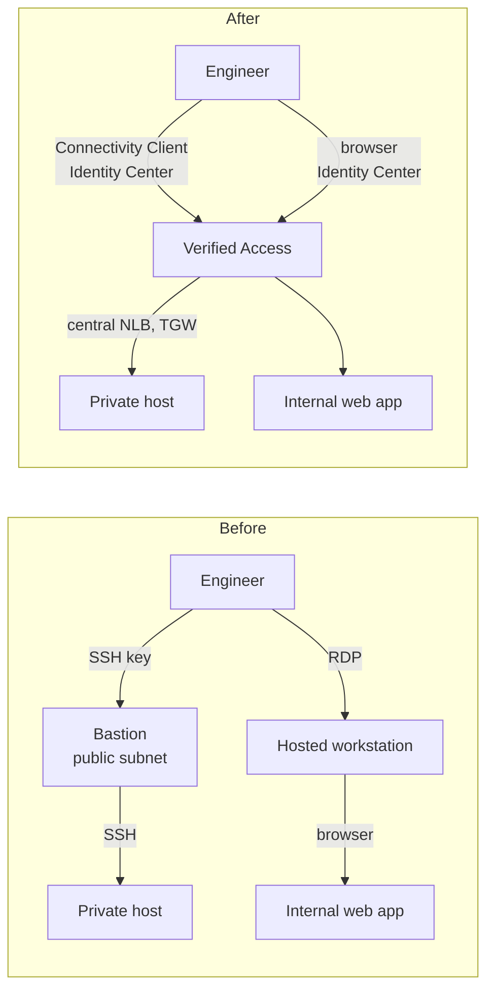

# Migrating a tenant from a bastion

Moving a tenant that reaches a private Linux host over SSH through a bastion, and an internal web application through a hosted workstation. The example values are illustrative.

## Before and after

## Steps

| # | Step | Who | Example |
| --- | --- | --- | --- |
| 1 | **Inventory** what the bastion and workstation are used for: hosts, ports, applications, and who uses them | Tenant + platform | SSH to `10.50.0.10:22`; web application on `10.50.0.20:80`; ten engineers |
| 2 | **Map users to identity groups**; create a group if none fits | Platform + identity owner | An `Engineers` group in the identity provider |
| 3 | **Allow the endpoint subnets** in the tenant's security groups (security groups cannot reference across a transit gateway, so use the subnet ranges) | Tenant | The three endpoint subnets on ports 22 and 80 |
| 4 | **Request access** through the service desk | Tenant | — |
| 5 | **Pull request** in the deployment repository: endpoint, load balancer target, group policy, reviewed Cedar | Platform | An SSH endpoint and a web endpoint, the load balancer targets |
| 6 | **HTTPS only:** application domain CNAME to the endpoint domain; certificate validation record (once per domain) | DNS owner | `app.example.com` |
| 7 | **Distribute the Connectivity Client** and its configuration (MDM in production) | Platform / end user computing | The configuration exported from the instance, delivered by MDM |
| 8 | **Run in parallel**: users try Verified Access while the bastion remains | Tenant | — |
| 9 | **Verify**: allowed users connect, a user outside the group is denied, both appear in the logs | Platform | — |
| 10 | **Remove the bastion**, its security group rules and its keys; close the workstation entitlements | Tenant | — |

Typical effort: about one day per tenant once the platform is in place, dominated by the inventory and the client rollout. Endpoint creation takes about 17 minutes; policy changes about 10 minutes.

## What Verified Access does not cover (gaps)

| Gap | Impact | What to do |
| --- | --- | --- |
| **No Linux Connectivity Client** (macOS and Windows only) | Linux users cannot use TCP endpoints | Keep a managed access route for Linux users, or provide a supported desktop |
| **File transfer and tooling** that lived on the bastion (scripts, `scp` hops, jump configuration) | Workflows change | `scp`/`sftp` work directly to the endpoint name through the client; move tooling to the users' machines or to automation |
| **Long running and idle sessions** | Idle TCP sessions drop after a few minutes (load balancer idle timeout) | SSH keep alives (`ServerAliveInterval 60`); raise the NLB listener idle timeout if needed |
| **Device posture for TCP** | Unconfirmed that Jamf, CrowdStrike or JumpCloud context applies to TCP endpoints | Test with the customer's device provider before relying on `sensitive` TCP endpoints |
| **HTTP requests over 60 seconds** | Return 504 | Applications with long requests stay on another route, or are changed |
| **Non TCP protocols** (UDP and others) | Not supported | Another route |
| **Automation and service accounts** (CI jobs that used the bastion) | Verified Access is for people | Use AWS Systems Manager, PrivateLink or pipeline roles |
| **Break glass** | If Identity Center or Verified Access is unavailable, there is no access | Keep a documented emergency route (for example Systems Manager Session Manager with approval) |
| **Cost per application** | Many small applications cost more than one bastion | See [cost](cost.md); consolidate ports per endpoint |
