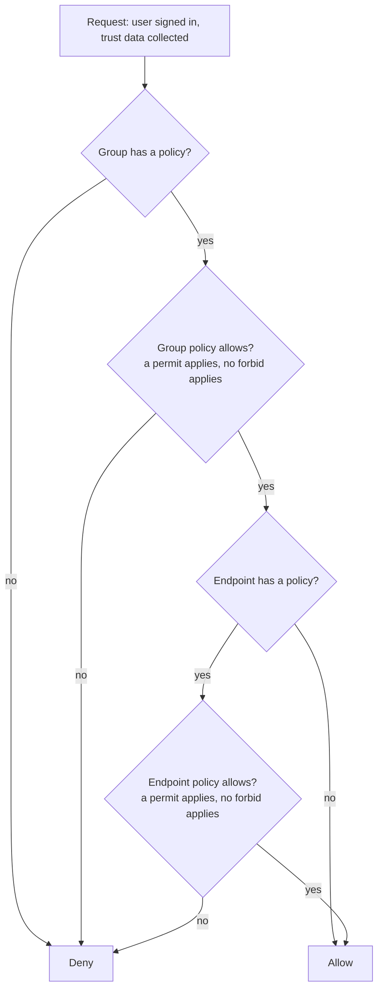

# Access policies

Who may reach what is decided by access policies written in [Cedar](https://www.cedarpolicy.com/), the policy language AWS Verified Access uses. This page explains enough Cedar to read and review those policies, how Verified Access evaluates them, how the module writes and checks them, and a cookbook of worked examples. You do not need to know Cedar before reading it.

The approval process around policies (pull requests, the policy gate, reviewed copies in `policies/`) is in [security](security.md#the-approval-gate).

## Cedar in five minutes

### Policies, statements and effects

A **policy document** (AWS also calls it a policy) is a piece of text attached to a Verified Access group or endpoint. It contains one or more **statements**, each ending in a semicolon. Every statement has an **effect**:

| Effect | Meaning |
| --- | --- |
| `permit` | Allow the request, if the statement's conditions hold |
| `forbid` | Deny the request, if the statement's conditions hold, whatever any `permit` says |

A statement looks like this:

```cedar
// Lines starting with // are comments
permit(principal, action, resource)
when {
  context.idc.groups has "11111111-1111-1111-1111-111111111111"
};
```

Read it as: "allow the request when the user's Identity Center groups include the group with this ID".

### Principal, action and resource

In general Cedar, `(principal, action, resource)` is the **scope** of a statement: who (principal) may do what (action) to which thing (resource). Verified Access does not use the scope. AWS requires it to stay undefined, written exactly as `(principal, action, resource)`, and everything is decided by the conditions instead ([policy statement structure](https://docs.aws.amazon.com/verified-access/latest/ug/auth-policies-policy-statement-struct.html)). Every Verified Access statement therefore starts with `permit(principal, action, resource)` or `forbid(principal, action, resource)`.

### Conditions: when and unless

| Clause | The statement applies when |
| --- | --- |
| `when { ... }` | The expression inside is true |
| `unless { ... }` | The expression inside is false |

Conditions are combined with `&&` (and), `||` (or) and `!` (not), and use the operators AWS lists in [built-in operators](https://docs.aws.amazon.com/verified-access/latest/ug/built-in-policy-operators.html):

| Operator | Example | Meaning |
| --- | --- | --- |
| `==`, `!=` | `context.jamf.risk == "LOW"` | Equal, not equal. Values of different types are never equal (`"22" == 22` is false) |
| `<`, `<=`, `>`, `>=` | `context.crowdstrike.assessment.overall >= 50` | Whole number comparisons |
| `has` | `context.idc.groups has "1111..."` | The record has this attribute (key) |
| `like` | `context.idc.user.email.address like "*@example.com"` | Text matches a pattern; `*` matches anything. Case sensitive |
| `.contains()` | `["LOW", "SECURE"].contains(context.jamf.risk)` | A set (list) contains a value |
| `.containsAny()`, `.containsAll()` | `context.okta.groups.containsAny(["a", "b"])` | A set contains any or all of another set |
| `ip(...).isInRange(ip(...))` | `ip(context.http_request.client_ip).isInRange(ip("203.0.113.0/24"))` | An address is in a range (used in AWS's [example policies](https://docs.aws.amazon.com/verified-access/latest/ug/trust-data-iam-add-pol.html)) |

### The context object

Everything a policy can look at is in one object called `context`. Verified Access fills it for each request with:

- **Trust data** from each trust provider (the services that vouch for the user or the device), under a key you choose called the **policy reference name**.
- **Request data** it adds itself: `context.http_request` for web (HTTP and HTTPS) endpoints or `context.tcp_flow` for TCP endpoints ([default context](https://docs.aws.amazon.com/verified-access/latest/ug/trust-data-default-context.html)).

In this module the policy reference names come from your inputs:

| Trust provider | Module input | Default key | What is under it (examples) |
| --- | --- | --- | --- |
| IAM Identity Center | `user_trust_provider.policy_reference_name` | `context.idc` | `groups` (keyed by group ID), `user.user_id`, `user.user_name`, `user.email.address`, `user.email.verified` |
| OIDC (Okta, Entra ID and others) | `user_trust_provider.policy_reference_name` | Set your own, for example `context.okta` | The claims your provider returns, for example `groups`, `email`, `email_verified` |
| CrowdStrike | `device_trust_provider.policy_reference_name` | `context.crowdstrike` | `assessment.overall`, `assessment.os`, `assessment.sensor_config` (1 to 100), `platform` |
| Jamf | `device_trust_provider.policy_reference_name` | `context.jamf` | `risk` (`HIGH`, `MEDIUM`, `LOW`, `SECURE`, `NOT_APPLICABLE`), `osv` |
| JumpCloud | `device_trust_provider.policy_reference_name` | `context.jumpcloud` | `device.is_managed`, `org_id` |

A trimmed example of the context for an SSH connection by an Identity Center user (the shape seen in access logs with trust context turned on):

```json
{
  "tcp_flow": { "client_ip": "203.0.113.10", "destination_ip": "10.50.0.10", "destination_port": 22 },
  "idc": {
    "user": { "user_name": "jane@example.com", "email": { "address": "jane@example.com", "verified": false } },
    "groups": { "11111111-1111-1111-1111-111111111111": { "group_name": "Engineers" } }
  }
}
```

So `context.idc.groups has "11111111-1111-1111-1111-111111111111"` is true for this user, and `context.idc.user.email.verified == true` is false. The fastest way to see the real context for your providers is an access log event with `access_logs.include_trust_context = true` ([what a log event tells you](security.md#what-a-log-event-tells-you)).

## How Verified Access evaluates a request

### Within one policy document

AWS describes the rule in [policy evaluation](https://docs.aws.amazon.com/verified-access/latest/ug/auth-policies-policy-eval.html):

| Situation in one document | Result |
| --- | --- |
| At least one `permit` applies and no `forbid` applies | Allow |
| No `permit` applies | Deny (the default is deny) |
| Any `forbid` applies | Deny, even if a `permit` also applies |

The order of statements does not matter.

### Group and endpoint policies

A **group** is a set of endpoints sharing one policy; an **endpoint** is one application. Each can carry a policy document:

| Group policy | Endpoint policy | Result |
| --- | --- | --- |
| None | Any | Deny: AWS blocks every request until a policy is defined ([policies](https://docs.aws.amazon.com/verified-access/latest/ug/auth-policies.html)) |
| Allows | None | Allow: only the group policy needs to allow |
| Allows | Allows | Allow |
| Allows | Denies | Deny |
| Denies | Any | Deny |

Both documents must allow, so an endpoint policy can only **narrow** what the group allows, never widen it.



### Can an endpoint have more than one policy?

No. AWS allows **one policy document per group and one per endpoint** (the API and CloudFormation take a single `PolicyDocument` string). But one document can hold **several statements**, which is how you express "this team, or that team from this range, but never this user".

In this module:

| Where | Inputs | What is rendered |
| --- | --- | --- |
| Group | `policy` (structured) **or** `raw_policy`, exactly one (checked at plan) | One document: a single `permit`, or your raw Cedar |
| Endpoint | Nothing, `sensitive = false` | No endpoint policy: the group policy alone decides |
| Endpoint | Nothing, `sensitive = true` | One `permit` requiring device posture |
| Endpoint | `policy` (structured) | One `permit`: any of its `identity_groups`, **and** every `additional_conditions` entry, **and** device posture when `sensitive` |
| Endpoint | `raw_policy` | Your raw Cedar as written. The device condition is **not** added for `sensitive` endpoints: write it yourself (lint rule L4 checks) |
| Endpoint | `policy` **and** `raw_policy` | Rejected at plan time: at most one per endpoint |

Within the structured inputs, `identity_groups` are combined with **or** and everything else with **and**. Anything needing a second statement (a `forbid`, or "group A, or group B only from an address range") needs `raw_policy`.

## How the module writes and checks policies

The full description, with the layers of checks, is in [security: how policies are rendered and checked](security.md#how-policies-are-rendered-and-checked). In short:

- **Structured first.** You list identity groups (and optionally conditions); the module renders the Cedar, sorted and de-duplicated, so the same input always produces the same text. The rendered text is in the `rendered_policies` output and reviewed as a copy in the deployment repository.
- **Raw as an escape hatch.** `raw_policy = { cedar = file("policies/raw/<name>.cedar"), owner, justification }` takes hand written Cedar, on a group or an endpoint. It still goes through lint and needs a security review.
- **Owner and justification.** Every policy names the accountable team (`owner`) and why the access exists (`justification`, one line, at least 10 characters). An endpoint `policy` inherits its group's unless it sets both. They are written into a header of `//` comments at the top of every rendered policy, which reviewers and the lint read:

```cedar
// managed-by: terraform-aws-verified-access
// kind: group
// name: platform-engineers
// source: structured
// owner: platform-team
// justification: Platform engineers administer the tenant hosts and tools
// user-context: idc
// device-context: crowdstrike
```

### Lint rules

`scripts/cedar-lint.sh` checks every rendered or raw policy. What each rule actually checks:

| Rule | Fails when |
| --- | --- |
| L1 | The text does not parse as Cedar (needs the official `cedar` CLI; without it the check is skipped with a warning unless `--require-parser` is given), or a statement starts with something other than `permit` or `forbid` |
| L2 | A `permit` has no `when` clause, or its `when` does not mention the trust provider context: a group `permit` must reference `context.<user-context>.`; an endpoint `permit` must reference the user or the device context |
| L3 | The header has no `owner`, or a `justification` shorter than 10 characters |
| L4 | A sensitive endpoint policy has no `permit` that references `context.<device-context>.` |
| L5 | The header lacks `managed-by: terraform-aws-verified-access`, a `kind` of `group` or `endpoint`, or a `user-context` |
| L6 | Never fails: lists every raw policy with its owner and justification, so reviewers always see them |
| L7 | The policy has no `permit` at all (a `forbid` only policy denies everything) |
| L8 | A `forbid` uses `context.http_request` or `context.tcp_flow` without a `context has "http_request"` (or `"tcp_flow"`) guard: on the other protocol it errors and is skipped, so it silently does not apply ([example 7](#7-read-only-auditors-permit-plus-forbid)) |

The lint is a text check, not a full analysis. It splits statements on `;`, so avoid semicolons inside strings in raw Cedar. Beyond L8 it does not check `forbid` statements, `unless` clauses or whether a condition is correct, only that a `permit` is scoped. A `permit` written only with `unless` fails L2: use `when`.

## Cookbook

Each example gives the scenario, the module input and the Cedar. Structured examples were rendered by the module (the same way as `tests/golden/*.cedar`, which several of them are). The header is shown once, in the first example, and omitted after that. The examples use IAM Identity Center with the default `idc` key and a CrowdStrike device provider unless they say otherwise. `# ... endpoint settings ...` stands for the endpoint's type, port and targets, which do not affect the policy.

### 1. One group, one team

Support engineers may reach the support hosts.

```hcl
  groups = {
    support = {
      policy = {
        identity_groups = ["22222222-2222-2222-2222-222222222222"]
        owner           = "support-team"
        justification   = "Support engineers troubleshoot customer environments"
      }
      endpoints = {
        support-ssh = {
          # ... endpoint settings ...
        }
      }
    }
  }
```

```cedar
// managed-by: terraform-aws-verified-access
// kind: group
// name: support
// source: structured
// owner: support-team
// justification: Support engineers troubleshoot customer environments
// user-context: idc
// device-context: crowdstrike
permit(principal, action, resource)
when {
  (
    context.idc.groups has "22222222-2222-2222-2222-222222222222"
  )
};
```

`support-ssh` has no endpoint policy, so this group policy alone decides.

### 2. Several teams on one group

Platform engineers and the on-call team share the same hosts. List both groups; a user in **either** is allowed.

```hcl
    platform-engineers = {
      policy = {
        identity_groups = [
          "11111111-1111-1111-1111-111111111111", # platform engineers
          "33333333-3333-3333-3333-333333333333", # on-call
        ]
        owner         = "platform-team"
        justification = "Platform engineers administer the tenant hosts and tools"
      }
```

```cedar
permit(principal, action, resource)
when {
  (
    context.idc.groups has "11111111-1111-1111-1111-111111111111" ||
    context.idc.groups has "33333333-3333-3333-3333-333333333333"
  )
};
```

With Identity Center, `identity_groups` must be group IDs, not names; the plan fails on a name. How to find the IDs is in [getting started](getting-started.md#identity-center-group-ids).

### 3. Narrow one endpoint to some of the group's teams

In the group of example 2, only on-call engineers may reach the production database. Give that endpoint its own `policy`:

```hcl
        prod-db = {
          # ... endpoint settings ...
          policy = {
            identity_groups = ["33333333-3333-3333-3333-333333333333"]
            owner           = "data-team"
            justification   = "Only the on-call engineers may reach the production database"
          }
        }
```

Endpoint policy:

```cedar
permit(principal, action, resource)
when {
  (
    context.idc.groups has "33333333-3333-3333-3333-333333333333"
  )
};
```

A platform engineer passes the group policy but fails this one, so is denied. Listing a group in the endpoint policy that is **not** in the group policy has no effect: its members still fail the group policy.

### 4. An extra condition: email domain

Anyone the group allows, but only with an `example.com` email address. `additional_conditions` takes Cedar expressions, one line each, no semicolons; each is wrapped in parentheses and joined with **and**.

```hcl
        tools-web = {
          # ... endpoint settings ...
          policy = {
            additional_conditions = ["context.idc.user.email.address like \"*@example.com\""]
          }
        }
```

```cedar
permit(principal, action, resource)
when {
  (context.idc.user.email.address like "*@example.com")
};
```

`like` is case sensitive: `Jane@Example.COM` does not match. Without `identity_groups`, an endpoint policy must reference the user or device context in a condition, as here, or the plan fails.

### 5. Sensitive endpoints: device posture

Mark an endpoint `sensitive = true` and it gets an endpoint policy requiring a healthy device, from the configured `device_trust_provider`. The plan fails if `sensitive` is set without a device provider (fail closed).

```hcl
  device_trust_provider = {
    type                  = "crowdstrike"   # or jamf, jumpcloud
    tenant_id             = "..."
    crowdstrike_min_score = 50              # CrowdStrike only, 1 to 100
    # jamf_allowed_risk   = ["LOW", "SECURE"] # Jamf only
  }
  # ...
        prod-ssh = {
          # ... endpoint settings ...
          sensitive = true
        }
```

The endpoint policy for each provider (from `tests/golden/endpoint-crowdstrike.cedar`, `endpoint-jamf.cedar` and `endpoint-jumpcloud.cedar`):

```cedar
// CrowdStrike: the overall assessment score is at least crowdstrike_min_score
permit(principal, action, resource)
when {
  context.crowdstrike.assessment.overall >= 50
};
```

```cedar
// Jamf: the device risk is one of jamf_allowed_risk
permit(principal, action, resource)
when {
  ["LOW", "SECURE"].contains(context.jamf.risk)
};
```

```cedar
// JumpCloud: the device is managed
permit(principal, action, resource)
when {
  context.jumpcloud.device.is_managed == true
};
```

Combined with an endpoint `policy`, the device condition is added last. For a sensitive endpoint narrowed to one group and two email domains (`tests/golden/endpoint-structured.cedar`):

```cedar
permit(principal, action, resource)
when {
  (
    context.idc.groups has "d242c5b0-6081-1845-6fa8-6e0d9513c107"
  ) &&
  (context.idc.user.email.address like "*@example.com" || context.idc.user.email.address like "*@example.org") &&
  context.crowdstrike.assessment.overall >= 50
};
```

Device trust data reaches Verified Access through a browser extension (and, for CrowdStrike, a native messaging host) on the user's device; whether it is available to **TCP** endpoints through the Connectivity Client is not confirmed (see [limitations](#limitations-and-gotchas)).

### 6. OIDC with a groups claim

With an OIDC provider, groups are matched by **name** in a claim of the user's token, with `.contains()`. The claim is `groups` by default; providers that put groups elsewhere set `oidc.groups_claim`, and a dotted path reaches a nested claim.

```hcl
  user_trust_provider = {
    type                  = "oidc"
    policy_reference_name = "okta"
    oidc = {
      # ... issuer, endpoints, client_id ...
      groups_claim = "additional_user_context.groups"
    }
  }
  groups = {
    platform-engineers = {
      policy = {
        identity_groups = ["platform-engineers", "admins"]
        owner           = "platform-team"
        justification   = "Platform engineers operate the demo tenant hosts"
      }
```

From `tests/golden/group-oidc-groups-claim.cedar`:

```cedar
permit(principal, action, resource)
when {
  (
    context.okta.additional_user_context.groups.contains("admins") ||
    context.okta.additional_user_context.groups.contains("platform-engineers")
  )
};
```

With the default claim it renders `context.okta.groups.contains("admins")` (`tests/golden/group-oidc.cedar`). Check where your provider really puts groups (a log event with trust context, or the provider's user info response) before setting it: a wrong claim denies everyone. Claims that are not plain names, such as URL namespaced claims, need `raw_policy` and the bracket form AWS documents, for example `context.okta["namespace:groups"]`.

### 7. Read-only auditors: permit plus forbid

Auditors may read web applications but never change anything: only `GET` and `HEAD` requests. This needs a `forbid`, so a raw group policy:

```hcl
    auditors = {
      raw_policy = {
        cedar         = file("policies/raw/auditors.cedar")
        owner         = "security-team"
        justification = "Auditors are read-only: only GET and HEAD requests to web applications"
      }
      endpoints = {
        # ... web endpoints ...
      }
    }
```

`policies/raw/auditors.cedar`:

```cedar
permit(principal, action, resource)
when {
  context.idc.groups has "44444444-4444-4444-4444-444444444444"
};
forbid(principal, action, resource)
unless {
  context has "http_request" &&
  ["GET", "HEAD"].contains(context.http_request.http_method)
};
```

Why `unless` rather than `forbid ... when { context.http_request.http_method != "GET" }`: on a TCP endpoint there is no `http_request`, so that `when` fails with an error. In standard Cedar a statement that errors is skipped, so the `forbid` would not apply and the `permit` would let auditors through to TCP endpoints. Written with `context has "http_request"` and `unless`, the `forbid` never errors and denies everything that is not a web read, TCP included. Lint rule L8 rejects the unguarded form.

### 8. HTTP-only conditions: method, path, client IP

Web endpoints get `context.http_request` with `http_method`, `hostname`, `path`, `query`, `port`, `user_agent`, `x_forwarded_for` and `client_ip`. TCP endpoints get only `context.tcp_flow` with `client_ip`, `destination_ip` and `destination_port` ([default context](https://docs.aws.amazon.com/verified-access/latest/ug/trust-data-default-context.html)). A reports application, read only, under `/reports/`, from the office range:

```hcl
        reports-web = {
          protocol = "http"
          # ... endpoint settings ...
          policy = {
            identity_groups = ["11111111-1111-1111-1111-111111111111"]
            additional_conditions = [
              "context.http_request.http_method == \"GET\"",
              "context.http_request.path like \"/reports/*\"",
              "ip(context.http_request.client_ip).isInRange(ip(\"203.0.113.0/24\"))",
            ]
          }
        }
```

```cedar
permit(principal, action, resource)
when {
  (
    context.idc.groups has "11111111-1111-1111-1111-111111111111"
  ) &&
  (context.http_request.http_method == "GET") &&
  (context.http_request.path like "/reports/*") &&
  (ip(context.http_request.client_ip).isInRange(ip("203.0.113.0/24")))
};
```

Only use `http_request` conditions on `http` or `https` endpoints: on a TCP endpoint the `permit` errors and the endpoint denies everyone. The module does not check this. AWS's own example shows a path without a leading slash (`app/images`), so check the exact format in a log event before relying on a path condition. For TCP, the same client range is `ip(context.tcp_flow.client_ip).isInRange(ip("203.0.113.0/24"))`.

### 9. Break-glass access

An emergency group that is normally empty, given access in advance, so that in an incident someone is added to the group in the identity provider (no policy change, no pull request, no wait for policy propagation). Here the on-call group may always reach the RDP hosts, and break-glass members only from the incident response range.

Add the break-glass group to the group policy (both documents must allow), then narrow it on the endpoint with a raw policy of two `permit` statements:

```hcl
    platform-engineers = {
      policy = {
        identity_groups = [
          "11111111-1111-1111-1111-111111111111", # platform engineers
          "33333333-3333-3333-3333-333333333333", # on-call
          "55555555-5555-5555-5555-555555555555", # break-glass, normally empty
        ]
        # ... owner, justification ...
      }
      endpoints = {
        hosts-rdp = {
          # ... endpoint settings ...
          raw_policy = {
            cedar         = file("policies/raw/hosts-rdp.cedar")
            owner         = "security-team"
            justification = "On-call always, break-glass only from the incident response range"
          }
        }
      }
    }
```

`policies/raw/hosts-rdp.cedar`:

```cedar
permit(principal, action, resource)
when {
  context.idc.groups has "33333333-3333-3333-3333-333333333333"
};
permit(principal, action, resource)
when {
  context.idc.groups has "55555555-5555-5555-5555-555555555555" &&
  ip(context.tcp_flow.client_ip).isInRange(ip("203.0.113.0/24"))
};
```

Two points to review: the break-glass group in the group policy also reaches every other endpoint in the group that has no endpoint policy of its own (give those endpoints a `policy`, or keep break-glass endpoints in a group of their own); and alert on membership changes to the break-glass group in the identity provider. How quickly a membership change reaches a user who is already signed in is not documented by AWS and is untested.

### 10. Block one user

Usually you remove the user from the group in the identity provider. When that is not possible straight away (for example, membership is managed by another team), a `forbid` blocks them while the rest of the group keeps access:

```hcl
    contractors = {
      raw_policy = {
        cedar         = file("policies/raw/contractors.cedar")
        owner         = "security-team"
        justification = "One contractor is blocked pending an investigation"
      }
      # ... endpoints ...
    }
```

```cedar
permit(principal, action, resource)
when {
  context.idc.groups has "66666666-6666-6666-6666-666666666666"
};
forbid(principal, action, resource)
when {
  context.idc.user.email.address == "contractor@example.com"
};
```

The block takes effect after policy propagation (several minutes), like any policy change. Match on an attribute the user cannot change; `user.user_id` (seen in a log event with trust context) is more stable than an email address.

## Limitations and gotchas

| Gotcha | What happens | What to do |
| --- | --- | --- |
| **One policy document per group and per endpoint** | You cannot attach a second policy to an endpoint | Put several statements in one document (`raw_policy`) |
| **No published policy size limit** | AWS's [quotas](https://docs.aws.amazon.com/verified-access/latest/ug/verified-access-quotas.html) and API reference give no maximum size for a policy document (not verified by testing) | Keep policies short: structured input, one group per audience |
| **No schema validation** | AWS checks the syntax when a policy is set, but not the attribute names ([policy evaluation](https://docs.aws.amazon.com/verified-access/latest/ug/auth-policies-policy-eval.html)). A typo such as `context.icd.groups` or a wrong OIDC claim is accepted, then errors on every request and denies (fails closed, silently) | Copy paths from a log event with trust context; let the module render the paths; test with a real user after every change |
| **A `forbid` that errors does not deny** | In standard Cedar a statement that errors is skipped, so a `forbid` on an attribute that is missing for some requests (for example `http_request` on TCP) does not block them. AWS says a reference to missing data "will evaluate the policy to deny" but does not say how an erroring `forbid` behaves (not verified) | Guard with `context has "..."` and prefer `forbid ... unless`, as in [example 7](#7-read-only-auditors-permit-plus-forbid) |
| **Types must match** | `"22" == 22` is false, without an error. AWS documents `tcp_flow.destination_port` as a string with the example value `22` | Check the type in a log event before comparing |
| **Context differs per trust provider** | Identity Center keys `groups` by group ID (`has`); OIDC groups are a list of names (`.contains()`); OIDC claims depend on the provider and scopes | Use the module's structured input; for OIDC check the claim first ([example 6](#6-oidc-with-a-groups-claim)) |
| **Context differs per protocol** | Web endpoints get `http_request` (method, host, path, query, port, user agent, X-Forwarded-For, client IP); TCP endpoints get only `tcp_flow` (client IP, destination IP, destination port): no user agent, path or method | Only use `http_request` on `http` and `https` endpoints ([example 8](#8-http-only-conditions-method-path-client-ip)) |
| **Device context on TCP endpoints is unconfirmed** | AWS documents device trust data through browser extensions; the Connectivity Client page says it "adds user identity information and device context" but no page confirms device trust providers for TCP (risk R1, not verified) | Test with the device provider before marking TCP endpoints `sensitive` |
| **No time of day** | The context has no request time, so "office hours only" cannot be written | Not possible in Verified Access |
| **Group IDs versus names** | Identity Center policies use group IDs (a renamed group keeps working); OIDC uses names (a renamed group silently loses access). Identity Center users can be in up to 1,000 groups; OIDC claims are limited to 11 KB ([quotas](https://docs.aws.amazon.com/verified-access/latest/ug/verified-access-quotas.html)) | The plan rejects names with Identity Center; rename OIDC groups with care |
| **`email.verified` can be false** | Identity Center reports `email.verified = false` in some setups (for example users provisioned from an external directory), so requiring it denies everyone | `require_verified_email` is off by default; turn it on only where emails are verified ([identity](security.md#identity)) |
| **Changes are not instant** | AWS says a policy change takes "several minutes" ([modify a group policy](https://docs.aws.amazon.com/verified-access/latest/ug/modify-verified-access-group-policy.html)); in testing it was 5 to 10 minutes | Allow for the delay when granting or revoking, and when testing a change |
| **A denied TCP connection looks like a timeout** | Users cannot tell denied from broken; browsers get a 403 page | Check the `denied-requests` query ([troubleshooting](operations.md#troubleshooting)) |
| **Policies only see the context** | No entities are passed in, so a policy cannot reference other policies, look up users or groups, or use entity hierarchies (`principal in Group::"..."` never matches) | Express everything as conditions on `context` |
| **Other Cedar features** | Policy templates need a separate linking step that the Verified Access API does not offer; the `datetime` extension has no time to work on; AWS does not say which Cedar version it runs (not verified), so newer syntax may be rejected when the policy is set | Stick to the [documented operators](https://docs.aws.amazon.com/verified-access/latest/ug/built-in-policy-operators.html) and `ip()` |
| **Policy reference names are fixed in policies** | Renaming `policy_reference_name` changes every `context.<name>` path; raw policies keep the old name and deny | Choose the names once; update raw policies with them |
| **Raw endpoint policies on sensitive endpoints** | The module does not add the device condition to a `raw_policy` | Write it yourself; lint rule L4 fails without it |

## Sources

- [Verified Access policies](https://docs.aws.amazon.com/verified-access/latest/ug/auth-policies.html): no policy blocks all requests.
- [Policy statement structure](https://docs.aws.amazon.com/verified-access/latest/ug/auth-policies-policy-statement-struct.html): undefined scope, comments, bracket form for reserved characters.
- [Built-in operators](https://docs.aws.amazon.com/verified-access/latest/ug/built-in-policy-operators.html).
- [Policy evaluation](https://docs.aws.amazon.com/verified-access/latest/ug/auth-policies-policy-eval.html): permit and forbid, group and endpoint, no data validation.
- [Policy logic short-circuiting](https://docs.aws.amazon.com/verified-access/latest/ug/auth-policies-policy-eval-short-circ.html): missing data and `has`.
- [Example policies](https://docs.aws.amazon.com/verified-access/latest/ug/trust-data-iam-add-pol.html): Identity Center group IDs, OIDC groups, client IP with `ip()`.
- [Default context](https://docs.aws.amazon.com/verified-access/latest/ug/trust-data-default-context.html): `http_request` and `tcp_flow`.
- [IAM Identity Center context](https://docs.aws.amazon.com/verified-access/latest/ug/trust-data-iam.html) and [third-party context](https://docs.aws.amazon.com/verified-access/latest/ug/trust-data-third-party-trust.html) (Jamf, CrowdStrike, JumpCloud, browser extensions).
- [Connectivity Client](https://docs.aws.amazon.com/verified-access/latest/ug/connectivity-client.html).
- [Quotas](https://docs.aws.amazon.com/verified-access/latest/ug/verified-access-quotas.html).
- [Modify a group policy](https://docs.aws.amazon.com/verified-access/latest/ug/modify-verified-access-group-policy.html): changes take several minutes.
- [AWS::EC2::VerifiedAccessGroup](https://docs.aws.amazon.com/AWSCloudFormation/latest/TemplateReference/aws-resource-ec2-verifiedaccessgroup.html) and [ModifyVerifiedAccessEndpointPolicy](https://docs.aws.amazon.com/AWSEC2/latest/APIReference/API_ModifyVerifiedAccessEndpointPolicy.html): one `PolicyDocument` per group and endpoint.
- [Cedar documentation](https://docs.cedarpolicy.com/): evaluation, errors, templates.
