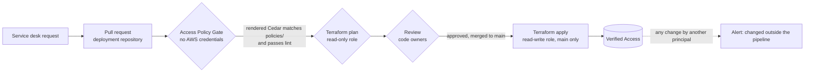

# Security

How access is approved, how policies are checked before they reach AWS, how identity is used, and what is logged. Diagrams of the network and traffic paths are in [how it works](how-it-works.md).

## The approval gate

Access follows a two stage model: a tenant provisions its service, and only the platform team wires up access to it. A tenant cannot expose its own service ([ADR 0001](adr/0001-endpoints-in-network-account.md)).

### Where the gate sits and who holds it



| Control | Where | Held by |
| --- | --- | --- |
| Only the platform team can create endpoints | Endpoints live in the network account; tenants have no access there, and groups are not shared to tenant accounts | Platform team |
| Every change is a pull request | Deployment repository; the pipeline role can only apply from `main` | Platform team |
| Review is mandatory | `CODEOWNERS` plus branch protection on `main` (require code owner review, require the gate and plan checks, no bypass) | Code owners (the platform team) |
| The effective policy is reviewed, not just the intent | `policies/*.cedar` must match what the module renders, or the gate fails | Reviewer |
| Unsafe policies cannot be merged | Cedar lint rules L1 to L9 (parse, no unscoped permit, owner and justification, device context on sensitive endpoints, no forbid that is silently skipped, no permit ORed with `true`) | The pipeline |
| Changes outside the pipeline are detected | EventBridge rule on Verified Access write APIs by any principal other than the pipeline role, to the alarm topic (module `alarms.pipeline_role_name`, alarm [A7](operations.md#alarms)); the rule covers the whole account and region, so use one pipeline role per account | Platform team (alert recipients) |

> **Branch protection must be enabled** on the deployment repository's `main`. Without it, anyone with write access can push to `main` and the pipeline applies the change unreviewed.

### Requesting access

1. The tenant raises a service desk request: the service, its private address and port, and who needs access.
2. A platform engineer opens a pull request in the deployment repository: the endpoint with its `targets` and the group, with the rendered Cedar in `policies/`.
3. The policy gate and plan run; the platform team reviews and merges; the pipeline applies.
4. The service desk ticket links the pull request, which is the audit trail.

The exact changes are in [everyday tasks](getting-started.md#everyday-tasks).

### Audit trail for one approval

1. **Request:** the service desk ticket (who asked, why).
2. **Pull request:** the author, the reviewers and approvals, the tfvars change (intent) and the `policies/*.cedar` diff (effect), with the plan as a comment.
3. **Pipeline run:** the gate result, the plan and the apply log, linked from the merge commit.
4. **CloudTrail:** `ModifyVerifiedAccessGroupPolicy` (and similar) by the pipeline role, with the time it took effect.
5. **Access logs:** every allowed and denied attempt afterwards, with the user and their groups.

### A worked example

Revoking a group's access and granting another: the author changes `identity_groups` in the deployment repository's tfvars. The gate **fails** until the reviewed copy in `policies/` is updated, so the pull request shows the exact effect:

```diff
 permit(principal, action, resource)
 when {
   (
-    context.idc.groups has "11111111-1111-1111-1111-111111111111"
+    context.idc.groups has "22222222-2222-2222-2222-222222222222"
   )
 };
```

After review and merge the pipeline applies it; in testing, changes took effect within about 10 minutes, and a user outside the new group was denied.

### The escape hatch (raw Cedar)

When the structured input cannot express a rule:

1. Write `policies/raw/<name>.cedar` in the deployment repository and reference it as `raw_policy = { cedar = file(...), owner = "...", justification = "..." }` (on a group, or on an endpoint for an endpoint policy).
2. Lint still runs (a raw policy cannot contain an unscoped permit), and rule L6 lists every raw policy in the job summary.
3. `CODEOWNERS` on `/policies/raw/` requires the security reviewers' approval.
4. The pull request template asks why the structured interface was not enough; repeated needs become structured features.

### Optional organisation guardrail

A service control policy denying `ec2:CreateVerifiedAccessEndpoint` and `ec2:ModifyVerifiedAccess*` outside the network account (or for principals other than the pipeline role) makes the gate impossible to bypass even for account administrators.

## How policies are rendered and checked

Policies are declared as structured input (`groups[*].policy`: `identity_groups`, `owner`, `justification`) and rendered to [Cedar](https://www.cedarpolicy.com/) by the module, with deterministic output and a machine readable header. New to Cedar? [Access policies](policies.md) explains it, with worked examples. Reviewers read the input and the `rendered_policies` output, not hand written Cedar ([ADR 0005](adr/0005-policies-reviewed-as-rendered-cedar.md)). Each access change touches two files, the intent and the effect: intended friction.

| Layer | What it does | Where |
| --- | --- | --- |
| **Plan time validation** | Rejects malformed or over-broad input, for example an empty `identity_groups` (an unscoped permit, which would let anyone who can sign in through), Identity Center group names instead of ids, an endpoint condition that could close its parentheses (V83), a missing owner or a justification under 10 characters, or an endpoint marked `sensitive` without a `device_trust_provider` | `variables.tf`, at `terraform plan` |
| **Sensitive endpoints** | Receive an endpoint policy requiring device posture; group and endpoint policies must both allow | Module, `sensitive = true` on an endpoint |
| **Endpoint policies** | Narrow one endpoint within its group, rendered and linted like group policies ([endpoint policies](#endpoint-policies)) | Module, `policy` on an endpoint |
| **Lint** | `scripts/cedar-lint.sh` checks rendered and raw policies against the rule set documented in the script (L1 to L9: parse with the official Cedar CLI, no unscoped permit, owner and justification, device context on sensitive endpoints, raw policies listed, protocol specific forbids guarded, no permit ORed with `true`); `scripts/test-cedar-lint.sh` proves each rule | The Access Policy Gate in the deployment pipeline |
| **Golden files** | `tests/policy.tftest.hcl` asserts the rendered Cedar for each scenario against `tests/golden/*.cedar`, so a change in policy semantics is visible in the diff | This repository |
| **Reviewed copy** | The deployment repository keeps a copy of every rendered policy in `policies/`; a test fails if they differ, so every access change shows its Cedar diff in the pull request | Deployment repository |
| **Escape hatch** | `raw_policy` accepts hand written Cedar where the structured input cannot express a rule; keep raw policies in a dedicated directory protected by `CODEOWNERS` so they always receive a security review | Deployment repository |

### Endpoint policies

A group policy decides who may reach any endpoint in the group. An endpoint can carry its own structured policy to narrow that further, for example to the on-call group only, or to staff with an `example.com` address:

```hcl
        prod-db = {
          # ... endpoint settings ...
          sensitive = true
          policy = {
            identity_groups       = ["22222222-2222-2222-2222-222222222222"]
            additional_conditions = ["context.idc.user.email.address like \"*@example.com\""]
            owner                 = "security-team"                                    # optional; defaults to the group's
            justification         = "Only the on-call engineers may reach production data" # set both or neither
          }
        }
```

It renders to one `permit` whose conditions are all combined with **AND**: any of the endpoint's `identity_groups`, then each additional condition wrapped in its own parentheses, then the device posture condition when the endpoint is `sensitive`. Verified Access evaluates the group policy and the endpoint policy and allows a request only if **both** allow it, so an endpoint policy can only narrow access, never widen it: a user must be in one of the group's identity groups **and** one of the endpoint's.

```cedar
permit(principal, action, resource)
when {
  (
    context.idc.groups has "22222222-2222-2222-2222-222222222222"
  ) &&
  (context.idc.user.email.address like "*@example.com") &&
  context.crowdstrike.assessment.overall >= 50
};
```

Plan time checks: an endpoint sets at most one of `policy` and `raw_policy`; the policy must reference a trust provider (identity groups, `sensitive`, or a condition on the user or device context), as lint rule L2 requires; and Identity Center groups are ids.

What the module guarantees about the rendered text, and what it does not:

- **Identity groups cannot change the shape of the policy.** Each id or name is written into a Cedar string literal with backslashes and double quotes escaped, so an OIDC group named `x") || true || ["y` stays one string (`"x\") || true || [\"y"`) and `CORP\admins` stays `"CORP\\admins"` (`tests/golden/group-oidc-escaped.cedar`). Identity Center ids must match the IdentityStore group id pattern anyway.
- **Header values cannot leave their `//` comment.** Group and endpoint names are kebab-case, and an owner or justification with a line feed or carriage return is rejected at plan time (and replaced with a space in the header as a second line of defence).
- **An additional condition stays inside its parentheses.** Validation V83 removes the condition's string literals (honouring `\"` and `\\` escapes) and then requires its brackets, `()`, `[]` and `{}`, to balance without ever closing more than were opened, and rejects `;`, line breaks, `//` comments, unterminated strings and the keywords `permit`, `forbid`, `when` and `unless`. So `context.idc.user.email.address like "*") || (true` and `true) || (true) || (true` are rejected at plan time: neither can close the parentheses the module adds and OR in a condition of its own. Terraform has no loops, so brackets are matched by removing innermost pairs ten times: brackets may nest at most **ten deep** in one condition.
- **What it does not guarantee:** that a condition is *meaningful*. A condition is Cedar you write, evaluated inside its parentheses and ANDed with the rest; `true`, or a test that always holds, narrows nothing. Nor does it check that the condition parses or refers to attributes that exist: AWS rejects a policy that does not parse when it is applied, and a condition on a missing attribute errors at request time, which denies. Review conditions like any other Cedar, and lint rule L9 flags a `permit` ORed with the literal `true`, the shape a break-out would take.

Anything the structured input cannot express still goes through `raw_policy`.

## Identity

- **Identity group membership is the access control** ([ADR 0003](adr/0003-identity-center-groups-as-the-control.md)): Identity Center group ids, or OIDC group names, sorted, in the rendered Cedar. Access is managed where identities already are, so joiners and leavers flow through the identity provider. Groups are created per audience, not per tenant.
- **The verified email condition is off by default** (`user_trust_provider.require_verified_email = false`). IAM Identity Center can report `email.verified = false` for every user (for example when users are provisioned from an external directory), and requiring it then denies everyone, including members of the permitted group. Turn it on only where the directory verifies emails; customers who rely on verified emails must opt in.
- **No device posture by default:** anyone in the group can connect from any device with the client. Customers with Jamf, CrowdStrike or JumpCloud can add a `device_trust_provider` (`crowdstrike_min_score`, default 50, or `jamf_allowed_risk`, default `LOW` and `SECURE`, for sensitive endpoints); device context for TCP endpoints must be tested first (risk R1).
- **OIDC:** the client secret is passed in `oidc_client_secret`; source it from a secret store, never from tfvars. Add `offline_access` to the scopes for the Connectivity Client. It is stored in Terraform state like any argument, so encrypt and restrict the state.
- **OIDC groups claim:** policies match group names in the `groups` claim of the user context (`context.<policy_reference_name>.groups`). Providers that put groups elsewhere are supported with `user_trust_provider.oidc.groups_claim`, for example `additional_user_context.groups` renders `context.okta.additional_user_context.groups.contains("admins")`. Check a log event with trust context (or the provider's user info response) for where the groups actually are before changing it: a wrong claim denies everyone. Claims that are not plain names (for example URL namespaced claims) need `raw_policy`.
- **OIDC native application client:** the Connectivity Client uses the browser client (`client_id`, `scope`, `oidc_client_secret`) unless `native_client_id`, `native_scope` and `oidc_native_client_secret` configure a separate native application client, as some identity providers require. The `oidc_redirect_uris` output lists the sign-in redirect URI to register for each web application.
- **Encryption:** `kms_key_arn` encrypts the trust providers, groups and endpoints with a customer managed key.

The supported providers are listed in [trust providers](how-it-works.md#trust-providers).

## Identity passed to applications

After a user is allowed, Verified Access adds the header **`x-amzn-ava-user-context`** to every request it forwards to a **web (HTTP) endpoint**. TCP endpoints get no header (there is no HTTP request to carry it). The header is a JSON Web Token (JWT), signed by AWS, so the application can trust who the user is without its own sign-in ([AWS: user claims passing](https://docs.aws.amazon.com/verified-access/latest/ug/user-claims-passing.html)).

| | Identity Center | OIDC |
| --- | --- | --- |
| Signed claims (payload) | `user.user_id`, `user.user_name`, `user.email.address`, `user.email.verified`; **no groups** | The provider's claims: `sub`, `email`, `email_verified`, `groups`, and `additional_user_context` |
| JWT header `iss` | The trust provider ARN | The OIDC issuer URL |
| Best user identifier | `user.user_id` | `sub` |

The JWT header carries `alg` (`ES384`), `kid` (the signing key id), `signer` (the Verified Access instance ARN) and `exp` (120 seconds). To trust it, an application must, **before using any claim**:

1. **Check the signer:** the `signer` in the JWT header equals your instance ARN (module output `instance_arn`). Without this, a token from any other Verified Access instance would be accepted.
2. **Fetch the public key** for the `kid`: `https://public-keys.prod.verified-access.<region>.amazonaws.com/<kid>`, and cache it by `kid`.
3. **Verify the signature** with algorithm `ES384` only, and reject expired tokens.

Things to know:

- **The claims are signed, not encrypted.** Use HTTPS between the load balancer and the application where possible; with plain HTTP, make sure only the Verified Access path can reach the application (with `topology = "hub"` the tenant security group allows only the endpoint subnets).
- **Applications without internet access** cannot reach the public key URL. Fetch the keys on a schedule into the VPC (for example to S3 or Parameter Store) and have the application read them there; AWS publishes a sample of this pattern (`aws-samples/sample-verified-access-jwt-private-distribution`).
- **Use claims for who, not for access.** The access decision is the Cedar policy; use the claims to personalise or audit inside the application. With Identity Center, group membership is not in the claims.

## Pipeline role permissions

The role the deployment pipeline assumes needs `ReadOnlyAccess` (plans read everything) plus the statements below for the default options. Resources are scoped by the `name_prefix` (default `verified-access`): every load balancer, target group, alarm, dashboard, EventBridge rule and SNS topic the module creates is named `<name_prefix>-*`, and every security group carries the tag `Name=<name_prefix>-*`. This is the set a working deployment uses, with IAM Access Analyzer reporting no findings.

| Statement | Actions | Resources |
| --- | --- | --- |
| Verified Access | `ec2:*VerifiedAccess*`, `verified-access:*` | `*` |
| Verified Access tags | `ec2:CreateTags`, `ec2:DeleteTags` | `arn:aws:ec2:*:*:verified-access-*` |
| Service linked role | `iam:CreateServiceLinkedRole`, condition `iam:AWSServiceName = verified-access.amazonaws.com` | `arn:aws:iam::*:role/aws-service-role/verified-access.amazonaws.com/*` |
| Identity Center application (Identity Center trust providers only) | `sso:CreateManagedApplicationInstance`, `sso:DeleteManagedApplicationInstance`, `sso:GetSharedSsoConfiguration`, `sso:PutApplicationAccessScope`, `sso:DeleteApplicationAccessScope`, `sso:PutApplicationAuthenticationMethod`, `sso:DeleteApplicationAuthenticationMethod`, `sso:PutApplicationGrant`, `sso:DeleteApplicationGrant`, `sso:PutApplicationAssignmentConfiguration` (needed to create endpoints, missing from AWS's documented permissions) | `*` |
| Security groups | `ec2:CreateSecurityGroup`; `ec2:CreateTags` with condition `ec2:CreateAction` in `CreateSecurityGroup` and the `CreateVerifiedAccess*` actions; `ec2:AuthorizeSecurityGroup*`, `ec2:RevokeSecurityGroup*`, `ec2:ModifySecurityGroupRules`, `ec2:UpdateSecurityGroupRuleDescriptions*`, `ec2:DeleteSecurityGroup`, `ec2:CreateTags`, `ec2:DeleteTags`, with condition `aws:ResourceTag/Name` like `<name_prefix>-*` | `*`; `arn:aws:ec2:*:*:security-group/*` |
| Access logs | `logs:*` (log group, metric filters, saved queries, log delivery) | `*` (narrow to `/aws/<name_prefix>/*` and the log delivery actions if required) |
| Access log bucket (S3 destination only) | `s3:*` | `arn:aws:s3:::*verified-access*` |
| Central load balancer (`hub`) | `elasticloadbalancing:*` | `arn:aws:elasticloadbalancing:*:*:` followed by `loadbalancer/net/<name_prefix>-*`, `listener/net/<name_prefix>-*`, `listener-rule/net/<name_prefix>-*` and `targetgroup/<name_prefix>-*` |
| Alarms and dashboard | `cloudwatch:*`, `events:*`, `sns:*` | `arn:aws:cloudwatch:*:*:alarm:<name_prefix>-*`, `arn:aws:cloudwatch::*:dashboard/<name_prefix>-*`, `arn:aws:events:*:*:rule/<name_prefix>-*`, `arn:aws:sns:*:*:<name_prefix>-*` |
| Certificate (`certificate`) | `acm:RequestCertificate` with condition `acm:ValidationMethod = DNS`; `acm:AddTagsToCertificate` | `*`; `arn:aws:acm:*:*:certificate/*` |

Options that need more, only when turned on:

| Option | Extra permissions |
| --- | --- |
| `certificate` destroy | `acm:DeleteCertificate` (or remove the certificate from state with a `removed` block before destroying, see [operations](operations.md)) |
| `waf` | `wafv2:CreateWebACL`, `GetWebACL`, `UpdateWebACL`, `DeleteWebACL`, `ListTagsForResource`, `TagResource`, `AssociateWebACL`, `DisassociateWebACL`, `GetWebACLForResource` |
| `alarms.create_kms_key` (or any `kms_key_arn`) | `kms:CreateKey`, `kms:PutKeyPolicy`, `kms:EnableKeyRotation`, `kms:CreateAlias`, `kms:DeleteAlias`, `kms:ScheduleKeyDeletion`, `kms:TagResource`; with a supplied key, `kms:DescribeKey`, `kms:GenerateDataKey*` and `kms:Decrypt` on it |
| `metric_stream` | `cloudwatch:PutMetricStream`, `GetMetricStream`, `DeleteMetricStream`, and `iam:PassRole` on the metric stream role |
| `metric_stream.create_role` | `iam:CreateRole`, `GetRole`, `DeleteRole`, `TagRole`, `PutRolePolicy`, `GetRolePolicy`, `DeleteRolePolicy`, `ListRolePolicies`, `ListAttachedRolePolicies`, `ListInstanceProfilesForRole` and `iam:PassRole` (condition `iam:PassedToService = streams.metrics.cloudwatch.amazonaws.com`) on `arn:aws:iam::*:role/<name_prefix>-*-metric-stream` |
| `create_kms_key`, `access_logs.cloudwatch.create_kms_key` | As `alarms.create_kms_key` above (`kms:CreateKey`, `PutKeyPolicy`, `EnableKeyRotation`, `CreateAlias`, `DeleteAlias`, `ScheduleKeyDeletion`, `TagResource`); for the Verified Access key also `kms:CreateGrant`, `DescribeKey`, `GenerateDataKey` and `Decrypt` (granted by the key policy to callers in the account via Verified Access); for the log group key `logs:AssociateKmsKey` (in `logs:*`) |
| `access_logs.s3.create` | `s3:CreateBucket`, `DeleteBucket`, `PutBucketTagging`, `PutBucketPolicy`, `DeleteBucketPolicy`, `PutBucketPublicAccessBlock`, `PutBucketOwnershipControls`, `PutBucketVersioning`, `PutEncryptionConfiguration`, `PutLifecycleConfiguration`, `PutBucketObjectLockConfiguration` and the matching `Get*` actions on `arn:aws:s3:::<name_prefix>-*` (already covered by the access log bucket statement above while the bucket name contains `verified-access`, as it does with the default `name_prefix`); with `kms_key_arn`, `kms:DescribeKey` and `kms:GenerateDataKey` on that key |
| `access_logs.firehose.create` | `firehose:CreateDeliveryStream`, `DeleteDeliveryStream`, `DescribeDeliveryStream`, `UpdateDestination`, `TagDeliveryStream`, `UntagDeliveryStream`, `ListTagsForDeliveryStream`, `StartDeliveryStreamEncryption` on `arn:aws:firehose:*:*:deliverystream/<name_prefix>-*`; `iam:CreateRole`, `GetRole`, `DeleteRole`, `TagRole`, `PutRolePolicy`, `GetRolePolicy`, `DeleteRolePolicy`, `ListRolePolicies`, `ListAttachedRolePolicies`, `ListInstanceProfilesForRole` and `iam:PassRole` (condition `iam:PassedToService = firehose.amazonaws.com`) on `arn:aws:iam::*:role/<name_prefix>-*-access-logs-firehose`; and, for Verified Access to deliver to any Firehose stream, `firehose:TagDeliveryStream` and `iam:CreateServiceLinkedRole` (the `AWSServiceRoleForLogDelivery` role) |
| `existing_instance` | Fewer: no instance, trust provider, logging or Identity Center application actions are used, only those for groups and endpoints (`ec2:*VerifiedAccess*`) on the existing instance |
| `dns` | `route53:ChangeResourceRecordSets`, `GetChange`, `GetHostedZone`, `ListResourceRecordSets` on the zone |
| Client configuration export (a manual workflow) | `ec2:ExportVerifiedAccessInstanceClientConfiguration` (already in `ec2:*VerifiedAccess*`) |

## Logging

Verified Access logs every access attempt, allowed or denied, in Open Cybersecurity Schema Framework (OCSF) format, to CloudWatch Logs, S3 or Firehose ([ADR 0004](adr/0004-logging-destinations-and-format.md)).

### Decisions

| # | Decision | Module default | Recommended deployment | Why |
| --- | --- | --- | --- | --- |
| LG1 | **Trust context** (identity and device data) in the logs | `include_trust_context = false` (data protection by default) | **On** | Investigation needs the identity: a denial is only explainable with the user's groups (see the example below). It is personal data, so retention is bounded |
| LG2 | **Destinations** | CloudWatch, S3 and Firehose all supported, any combination | CloudWatch **and** S3 in the log archive account | CloudWatch for live queries, metrics and alarms; S3 for long term, tamper resistant records |
| LG3 | **OCSF version** | `ocsf-1.0.0-rc.2` (AWS's own default is `ocsf-0.1`) | `ocsf-1.0.0-rc.2` | Not a preference: trust context **requires** rc.2, and `ocsf-0.1` cannot be used with TCP endpoints. The module rejects incompatible combinations at plan time |
| LG4 | **Retention** | The module creates the log group with 90 days | CloudWatch 90 days; production S3 1 year (lifecycle rule) | Bounded retention for personal data; long term copy where storage is cheap |
| LG5 | **Who can read, who cannot delete** | Optional: `access_logs.s3.create` with `object_lock` (otherwise the bucket is owned elsewhere) | Production: read limited to security and operations roles; S3 Object Lock (compliance mode) for the retention period | Object Lock makes the record tamper proof; it is irreversible, so it is not used for demo data |
| LG6 | **Encryption** | Optional key for the log group (`kms_key_arn`, or `create_kms_key`) and the created bucket (`access_logs.s3.kms_key_arn`, else SSE-S3) | A customer managed key on the log group and SSE-KMS on the bucket | Logs hold personal data; the pipeline role needs permission to use the keys |

The module warns at plan time when no access logging is configured. An S3 bucket in the log archive account, with its policy, is owned outside the module (the module deploys to one account); `access_logs.s3.create` creates a bucket in the Verified Access account instead, with versioning, a TLS only policy permitting log delivery from this account, a lifecycle expiry and optional Object Lock ([create or bring your own](how-it-works.md#create-or-bring-your-own)).

**Consistency with VPC flow logs:** treat access logs like flow logs, as network security records: same log archive account, same retention class, same read restrictions and immutability. Where an estate has no established flow log pattern to mirror, these decisions set it.

### What a log event tells you

A denied SSH attempt (trimmed). `include_trust_context = true` is what makes the `context` block, and therefore the reason, visible:

```json
{
  "class_name": "Authorization",
  "data": {
    "endpoint_type": "load-balancer",
    "protocol": "tcp",
    "authorizations": [{ "decision": "Deny", "policy": { "name": "inline" } }],
    "context": {
      "tcp_flow": { "client_ip": "203.0.113.10", "destination_ip": "10.10.2.98", "destination_port": 22 },
      "idc": {
        "user": { "user_name": "jane@example.com", "email": { "address": "jane@example.com", "verified": false } },
        "groups": { "11111111-1111-1111-1111-111111111111": { "group_name": "Engineers" } }
      }
    }
  },
  "status": "Failure",
  "status_code": "403",
  "privileges": ["vae-0123456789abcdef0"],
  "user": { "email_addr": "jane@example.com" }
}
```

Here the user is in a permitted group but `email.verified` is `false`: with `require_verified_email = true` this is the reason for the denial, which is why the condition is off by default.

### Where to find logs

| Need | Where |
| --- | --- |
| Live investigation | CloudWatch Logs Insights, saved queries `<name_prefix>/<name>/denied-requests` and `who-is-connecting` |
| Long term record | S3 in the log archive account |
| Who changed access | CloudTrail `ModifyVerifiedAccess*` events and the deployment repository's pull requests |
